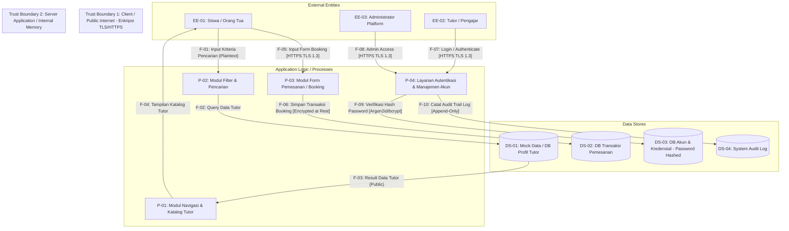

# Data Flow Diagram (DFD) Awal — TutorCare

Dokumen ini memuat arsitektur Data Flow Diagram (DFD) awal beserta batas kepercayaan (*Trust Boundary*) dan identifikasi penandaan proteksi kriptografi pada aliran data.

---

## 1. Diagram Mermaid DFD

---

## 2. Tabel Elemen & Proteksi Kriptografi

| ID Elemen | Nama Elemen | Jenis Elemen | Proteksi Kriptografi | Keterangan |
| :--- | :--- | :--- | :--- | :--- |
| **EE-01** | Siswa / Orang Tua | External Entity | - | Pengguna publik pencari tutor. |
| **EE-02** | Tutor / Pengajar | External Entity | - | Pengajar terverifikasi. |
| **EE-03** | Administrator Platform | External Entity | - | Pengelola sistem. |
| **P-01** | Modul Navigasi & Katalog | Process | - | Komponen UI menampilkan katalog tutor. |
| **P-02** | Modul Filter & Pencarian | Process | - | Memproses kriteria mata pelajaran/kelas/mode. |
| **P-03** | Modul Form Pemesanan | Process | **TLS 1.3 (Transit)** | Memvalidasi masukan nama & nomor kontak. |
| **P-04** | Layanan Autentikasi | Process | **bcrypt / Argon2id** | Memverifikasi kredensial login. |
| **DS-01** | DB Profil Tutor | Data Store | - | Menimpan data publik tutor. |
| **DS-02** | DB Transaksi Pemesanan | Data Store | **AES-256 (At Rest)** | Menyimpan jadwal & data pemesan. |
| **DS-03** | DB Akun & Kredensial | Data Store | **Salted Hash (One-Way)** | Menyimpan password yang telah di-hash. |
| **DS-04** | System Audit Log | Data Store | **HMAC / Signed Log** | Memastikan integritas jejak audit. |

---

## 3. Trust Boundary (Batas Kepercayaan)

1. **Trust Boundary 1 (TB-01: Public Internet vs Application Client):** Memisahkan browser pengguna yang tidak terenkripsi secara lokal dengan jalur transmisi jaringan yang dilindungi oleh enkripsi **TLS 1.3 / HTTPS**.
2. **Trust Boundary 2 (TB-02: Client Browser vs Server/Database Environment):** Memisahkan area masukan pengguna (*user input*) yang rentan injeksi dengan lingkungan proses server dan penyimpanan data sensitif yang dilindungi enkripsi *at-rest* dan *salted hashing*.