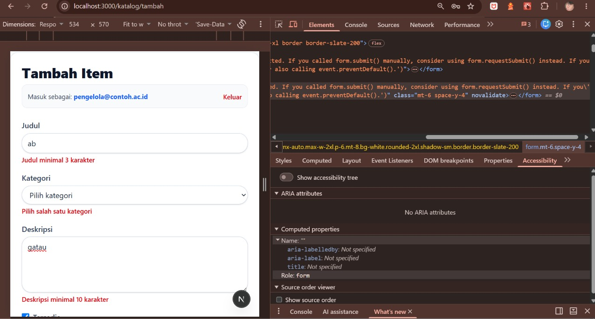
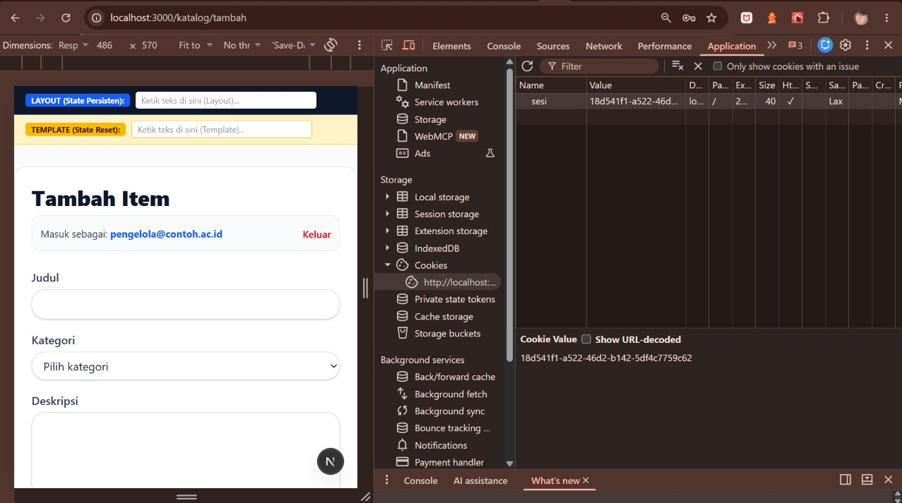
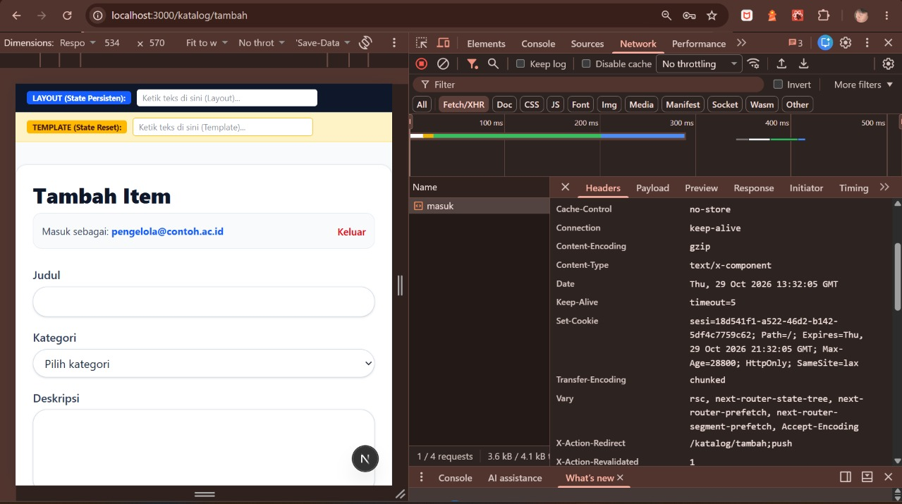
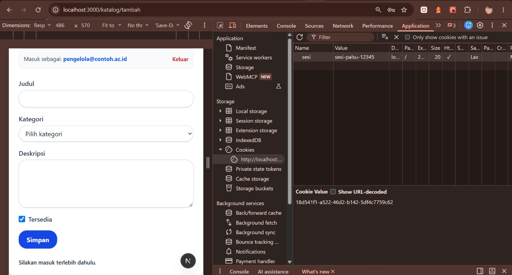
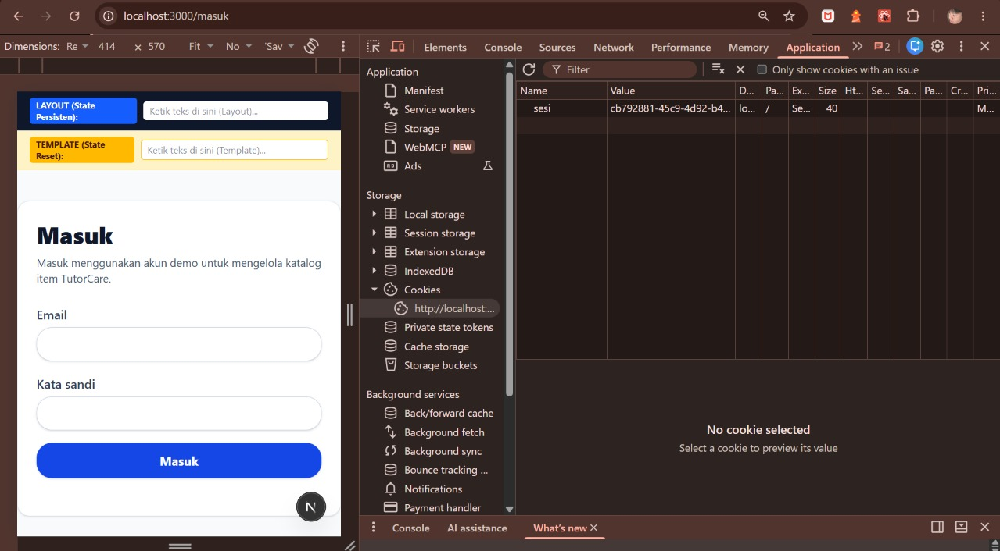

# Dokumen Teknis Modul 5 — Formulir, Validasi, Session, dan Cookie

**Nama/NIM** : Ahmad Zaidan / 105224044  
**Repositori** : [https://github.com/zaidanahd/TutorCare_105224044_WEB](https://github.com/zaidanahd/TutorCare_105224044_WEB)  
**Branch** : `praktikum/modul-05`  
**Produk Aplikasi** : TutorCare  

---

## 1. Skema Validasi

### A. Tabel Kolom Formulir Tambah Item
Berikut merupakan aturan validasi sintaksis menggunakan pustaka **Zod 4** yang diimplementasikan pada berkas `lib/skema.ts`:

| Nama Kolom | Aturan Zod 4 | Pesan Galat (*Error Message*) | Keterangan Teknis |
| :--- | :--- | :--- | :--- |
| `judul` | `z.string().trim().min(3).max(80)` | *"Judul minimal 3 karakter"* (jika &lt; 3)<br>*"Judul maksimal 80 karakter"* (jika &gt; 80) | Wajib berupa teks alfabet/string, spasi berlebih di awal/akhir otomatis di-trim oleh Zod. |
| `kategori` | `z.enum(["energi", "lingkungan", "kampus"], { error: "Pilih salah satu kategori" })` | *"Pilih salah satu kategori"* | Wajib memilih salah satu opsi nilai tetap yang selaras dengan tipe union `Kategori` di `lib/tipe.ts`. |
| `deskripsi` | `z.string().trim().min(10).max(300)` | *"Deskripsi minimal 10 karakter"* (jika &lt; 10)<br>*"Deskripsi maksimal 300 karakter"* (jika &gt; 300) | Menjelaskan detail konten item secara informatif dengan batas panjang yang ketat. |
| `tersedia` | `z.stringbool().default(false)` | *(Otomatis dikonversi ke boolean)* | Membaca input checkbox FormData ("on"/"true" $\rightarrow$ `true`, tidak dicentang $\rightarrow$ `false`). |

### B. Aturan Semantik yang Diperiksa di Server Action dan Alasannya
* **Pernyataan Aturan Semantik:**  
  > *"Judul item yang ditambahkan tidak boleh sama dengan judul item lain yang telah terdaftar di dalam sistem (`judulSudahAda(judul)` bernilai `false`), tanpa memedulikan perbedaan huruf besar dan kecil (*case-insensitive*)."*
* **Alasan Diperiksa di Server Action (bukan di Skema Zod):**  
  Skema Zod bersifat *stateless* (tanpa kondisi keadaan tersimpan) dan hanya memvalidasi bentuk data (*syntactic validation*) seperti tipe data, panjang string, dan pola karakter secara terisolasi. Skema Zod tidak memiliki akses langsung ke *state* sistem yang tersimpan pada memori server maupun database. Oleh karena itu, pemeriksaan keunikan judul wajib dieksekusi di dalam **Server Action** (`app/katalog/actions.ts`) setelah validasi bentuk `skemaItem.safeParse(mentah)` dinyatakan berhasil.

---

## 2. Alur Server Action

### A. Urutan Alur Pemeriksaan di Server Action (`simpanItem`)
Sesuai dengan standar keamanan aplikasi web dan panduan Modul 5, urutan eksekusi di dalam `app/katalog/actions.ts` dirancang dengan hierarki pemeriksaan berikut:

```
[Permintaan POST Formulir]
          │
          ▼
1. Pemeriksaan Sesi (bacaSesi) ──────► Gagal: Kembalikan pesan "Silakan masuk terlebih dahulu."
          │ Lolos
          ▼
2. Validasi Bentuk (safeParse) ──────► Gagal: Kembalikan z.flattenError(error).fieldErrors
          │ Lolos
          ▼
3. Validasi Semantik (judulSudahAda) ─► Gagal: Kembalikan galat { judul: ["Judul sudah dipakai item lain"] }
          │ Lolos
          ▼
4. Mutasi Data (tambahItem) ─────────► Gagal: Catat console.error di log server, pesan umum ke user
          │ Lolos
          ▼
5. Revalidasi & Redirect ────────────► revalidatePath("/katalog") lalu redirect(`/katalog/${id}`)
                                      (Wajib diletakkan di luar blok try-catch)
```

1. **Pemeriksaan Sesi (`bacaSesi`):** Memastikan cookie sesi ada di peramban dan ID sesi terdaftar di memori server serta belum kedaluwarsa.
2. **Validasi Bentuk (`skemaItem.safeParse`):** Memverifikasi integritas tipe data dan batas panjang masukan menggunakan Zod 4. Jika gagal, galat per kolom diekstrak melalui `z.flattenError(hasil.error).fieldErrors`.
3. **Validasi Semantik (`judulSudahAda`):** Mengecek apakah judul item duplikat terhadap data yang sudah ada di penyimpanan server.
4. **Mutasi Data (`tambahItem`):** Menghitung ID inkremental baru dan menyimpan entitas item ke dalam larik data server. Detail kesalahan teknis dicatat di server log (`console.error`), sementara antarmuka hanya menerima pesan umum untuk mencegah kebocoran informasi internal.
5. **Revalidasi dan Pengalihan (`revalidatePath` lalu `redirect`):** Menandai rute `/katalog` agar di-render ulang dengan data terkini, kemudian mengalihkan pengguna ke halaman detail `/katalog/${id}`. Panggilan `redirect` diletakkan **di luar blok `try-catch`** karena Next.js mengimplementasikan redirect melalui mekanisme pelemparan eksepsi khusus (`NEXT_REDIRECT`).

### B. Pembagian Berkas Arsitektur Komponen

| Berkas | Jenis Komponen / Direktif | Peran Teknis dalam Arsitektur |
| :--- | :--- | :--- |
| `app/katalog/tambah/page.tsx` | **Server Component** | Mengamankan halaman di level server (memeriksa sesi pengguna via `bacaSesi()` sebelum render). Jika tidak ada sesi, langsung melakukan pengalihan `redirect("/masuk")`. |
| `components/FormItem.tsx` | **Client Component** (`'use client'`) | Mengelola interaktivitas formulir dengan hook `useActionState(simpanItem, awal)`. Mengikat atribut aksesibilitas `aria-invalid` dan `aria-describedby` ke elemen masukan. |
| `app/katalog/actions.ts` | **Berkas Aksi Server** (`'use server'`) | Menampung fungsi Server Action `simpanItem` yang dieksekusi murni di lingkungan backend Node.js untuk pemrosesan form yang aman. |
| `app/masuk/actions.ts` | **Berkas Aksi Server** (`'use server'`) | Menangani mutasi sesi login (`masuk`) dan penghapusan cookie sesi (`keluar`). |
| `lib/sesi.ts` | **Modul Internal Server** (`import "server-only"`) | Mengelola manipulasi cookie sesi terenkripsi dengan atribut `HttpOnly`, `SameSite=Lax`, dan penyimpanan Map di memori. |

---

## 3. Bukti Uji Validasi

### A. Tabel 8 Kasus Uji Validasi Formulir
Pengujian dilakukan terhadap formulir penambahan item dengan kombinasi masukan valid, tidak valid, serta pengujian bypass validasi klien menggunakan atribut `novalidate`:

| No | Skenario Masukan | Status Klien | Hasil yang Diharapkan | Hasil Nyata | Status Uji |
| :---: | :--- | :---: | :--- | :--- | :---: |
| 1 | `judul`: `"ab"` (2 karakter), `kategori`: `"kampus"`, `deskripsi`: `"Deskripsi valid lebih dari sepuluh karakter"`, `tersedia`: `true` | **`novalidate`** (Bypass Klien) | Server menolak masukan, menampilkan pesan galat *"Judul minimal 3 karakter"* di bawah kolom judul (`aria-invalid="true"`). | Ditolak oleh server; pesan galat *"Judul minimal 3 karakter"* tampil di bawah input judul, nilai input lain tetap tersimpan. | **Lolos** |
| 2 | `judul`: `"Katalog Laboratorium Komputer"`, `kategori`: `""` (kosong), `deskripsi`: `"Deskripsi valid lebih dari sepuluh karakter"`, `tersedia`: `true` | **`novalidate`** (Bypass Klien) | Server menolak masukan, menampilkan pesan galat *"Pilih salah satu kategori"* di bawah elemen select kategori. | Ditolak oleh server; pesan galat *"Pilih salah satu kategori"* tampil tepat di bawah dropdown kategori. | **Lolos** |
| 3 | `judul`: `"Katalog Laboratorium Komputer"`, `kategori`: `"kampus"`, `deskripsi`: `"Singkat"` (7 karakter), `tersedia`: `true` | **`novalidate`** (Bypass Klien) | Server menolak masukan, menampilkan pesan galat *"Deskripsi minimal 10 karakter"* di bawah textarea deskripsi. | Ditolak oleh server; pesan galat *"Deskripsi minimal 10 karakter"* muncul, isian judul dan kategori tidak hilang. | **Lolos** |
| 4 | `judul`: `"Katalog Laboratorium Komputer"`, `kategori`: `"kampus"`, `deskripsi`: `[Teks sepanjang 350 karakter]`, `tersedia`: `true` | **`novalidate`** (Bypass Klien) | Server menolak masukan, menampilkan pesan galat *"Deskripsi maksimal 300 karakter"*. | Ditolak oleh server; pesan galat batas maksimum karakter muncul di bawah kolom deskripsi. | **Lolos** |
| 5 | `judul`: `"Modul Praktikum Next.js"` (Duplikat judul yang sudah ada), `kategori`: `"kampus"`, `deskripsi`: `"Deskripsi pengujian duplikasi data semantik pada sistem"`, `tersedia`: `true` | Normal (Klien Lolos) | Validasi bentuk Zod lolos, namun validasi semantik server menolak dan menampilkan pesan *"Judul sudah dipakai item lain"*. | Ditolak oleh validasi semantik server; pesan *"Judul sudah dipakai item lain"* muncul di bawah input judul, data form tidak di-reset. | **Lolos** |
| 6 | Pengiriman data formulir sah ketika cookie sesi kosong / belum login | Klien Lolos | Server Action menolak mutasi data pada langkah 1 dan mengembalikan pesan status *"Silakan masuk terlebih dahulu."*. | Mutasi dibatalkan server; pesan status umum *"Silakan masuk terlebih dahulu."* tampil di bagian bawah form. | **Lolos** |
| 7 | Halaman Masuk: `email`: `"pengelola@contoh.ac.id"`, `kataSandi`: `"sandi-salah"` | Normal | Skema Zod lolos, namun verifikasi kredensial gagal; server mengembalikan pesan *"Email atau kata sandi salah."*. | Login gagal, cookie sesi tidak dibuat, pesan *"Email atau kata sandi salah."* tampil di layar. | **Lolos** |
| 8 | **Happy Path:** Pengguna telah login; `judul`: `"Bimbingan Struktur Data Lanjutan"`, `kategori`: `"kampus"`, `deskripsi`: `"Pembelajaran intensif struktur data pohon biner dan graf."`, `tersedia`: `true` | Normal | Seluruh validasi lolos, data tersimpan, `revalidatePath("/katalog")` dieksekusi, dan pengguna dialihkan ke `/katalog/{id}`. | Berhasil disimpan; pengguna langsung dialihkan ke rute `/katalog/4`, item baru tampil pada katalog utama. | **Lolos** |

### B. Tangkapan Layar Pengujian Galat per Kolom
*Tangkapan layar pengujian validasi server dengan atribut `novalidate` terpasang (menolak masukan judul "ab", kategori kosong, dan deskripsi pendek):*  


---

## 4. Session dan Cookie

### A. Atribut Cookie Sesi dan Alasan Pemilihannya

| Atribut Cookie | Nilai Konfigurasi | Alasan Pemilihan Keamanan |
| :--- | :--- | :--- |
| **`HttpOnly`** | `true` | Mencegah skrip jahat di sisi klien (seperti serangan XSS melalui `document.cookie`) untuk mengakses atau mencuri token pengenal sesi. |
| **`Secure`** | `process.env.NODE_ENV === "production"` | Memastikan cookie hanya dikirimkan melalui saluran terenkripsi HTTPS pada lingkungan produksi (diizinkan pada HTTP localhost untuk keperluan pengembangan lokal). |
| **`SameSite`** | `"lax"` | Melindungi aplikasi dari serangan CSRF (*Cross-Site Request Forgery*) dengan menolak pengiriman cookie pada permintaan POST lintas domain berbahaya, sembari tetap mengizinkan navigasi tautan biasa dari situs luar. |
| **`Path`** | `"/"` | Menjadikan cookie sesi berlaku dan dapat dibaca di seluruh cakupan rute produk TutorCare (`/katalog`, `/katalog/tambah`, `/masuk`, dll.). |
| **`Max-Age`** | `28800` (8 Jam) | Membatasi rentang masa aktif sesi maksimal 8 jam guna mencegah penyalahgunaan sesi usang (*zombie session*) pada perangkat publik. |

### B. Bukti Tangkapan Layar Cookie Sesi (Nilai Disamarkan)
* *Tangkapan Layar Panel DevTools Application &gt; Cookies:*  
  
* *Tangkapan Layar Network Headers (Set-Cookie pada respon POST /masuk):*  
  

### C. Hasil Pengujian Skenario Keamanan Cookie

1. **Uji Cookie Palsu:**
   * *Langkah*: Masuk dengan akun demo, buka `/katalog/tambah`, lalu melalui panel DevTools *Application &gt; Cookies*, ubah nilai cookie `sesi` menjadi nilai acak palsu (misal: `"sesi-palsu-99999"`). Kemudian kirim formulir penambahan item.
   * *Hasil*: Berkas `proxy.ts` meloloskan navigasi rute karena kunci cookie `"sesi"` terdeteksi secara fisik. Namun saat formulir dikirim, Server Action mengeksekusi `bacaSesi()` yang mencari ID tersebut pada `Map` memori server. Karena ID palsu tidak terdaftar, server mengembalikan respon galat: *"Silakan masuk terlebih dahulu."* dan item **tidak tersimpan**.
   * *Bukti Tangkapan Layar:*  
     

2. **Uji Logout:**
   * *Langkah*: Mengklik tombol *"Keluar"* pada halaman `/katalog/tambah`.
   * *Hasil*: Server Action `keluar()` memanggil `hapusSesi()` yang menghapus ID dari penyimpanan `Map` server dan menghapus header cookie dari peramban (`toko.delete("sesi")`), lalu mengalihkan pengguna kembali ke halaman beranda (`/`).

3. **Uji Cookie Lama Setelah Logout:**
   * *Langkah*: Nilai cookie sesi sebelum logout dicatat. Setelah proses logout berhasil, nilai cookie lama dimasukkan kembali secara manual melalui DevTools *Application &gt; Cookies*, kemudian pengguna mencoba mengakses URL `/katalog/tambah`.
   * *Hasil*: Pengguna langsung dialihkan kembali ke rute `/masuk`. Hal ini membuktikan bahwa meskipun penyerang memiliki token cookie lama, sesi sudah dicabut (*revoked*) secara permanen dari penyimpanan server saat logout.
   * *Bukti Tangkapan Layar:*  
     

---

## 5. Keputusan Teknis

### A. Alasan Pola Session di Server Dibanding Token di Cookie (Stateless JWT)
1. **Kemampuan Pencabutan Sesi Seketika (*Instant Revocation*):**  
   Pada arsitektur sesi berbasis server (menggunakan `Map` di memori atau redis/database), sesi dapat langsung dibatalkan secara instan saat pengguna menekan tombol logout atau saat admin mencabut hak akses. Sebaliknya, token tanpa status (JWT) yang disimpan di cookie tidak dapat dicabut sebelum waktu kedaluwarsanya habis kecuali menggunakan mekanisme *blacklist* kompleks yang menghilangkan sifat stateless-nya.
2. **Efisiensi Ukuran Payload Cookie:**  
   Cookie sesi server hanya memuat string pengenal acak (UUID sepanjang 36 karakter), sehingga ukuran header HTTP permintaan sangat ringan. Token JWT membawa payload klaim data dan tanda tangan kriptografi yang berukuran jauh lebih besar (ratusan hingga ribuan bita) yang membebani setiap transmisi HTTP request.
3. **Pemisahan Data Sensitif dari Klien:**  
   Informasi profil dan izin pengguna disimpan aman di memori server dan tidak pernah terekspos ke penyimpanan browser klien.

### B. Batas Peran `proxy.ts` Dibanding Pemeriksaan di Aksi
* **Peran `proxy.ts` (Next.js 16 File Convention):**  
  `proxy.ts` bertindak sebagai **penyaring optimistik awal (*optimistic guard*)** di tingkat jaringan/edge sebelum sebuah rute Server Component dirender. Tujuannya adalah menghemat sumber daya komputasi server dengan langsung mengalihkan pengunjung awam tanpa cookie ke `/masuk`. Namun, `proxy.ts` hanya memeriksa keberadaan cookie (`request.cookies.has("sesi")`) tanpa memverifikasi apakah isi cookie tersebut sah atau telah dimanipulasi.
* **Peran Pemeriksaan di Server Action:**  
  Pemeriksaan di dalam Server Action (`bacaSesi()`) bertindak sebagai **batas keamanan mutlak (*authoritative security boundary*)**. Server Action melakukan verifikasi kriptografis dan pencocokan ke *data store* server. Meskipun penyerang berhasil melewati `proxy.ts` dengan memasang cookie tiruan atau memanggil endpoint POST secara langsung via `curl`/Postman, Server Action akan tetap menolak eksekusi mutasi data.

---

## 6. Kendala dan Penyelesaian

1. **Kompatibilitas Partial Prerendering (PPR) pada Rute Dinamis dengan Runtime Cookies:**
   * *Kendala*: Pemanggilan `bacaSesi()` yang mengeksekusi `(await cookies())` di dalam Server Component `app/katalog/tambah/page.tsx` memicu galat kompilasi build `Route "/katalog/tambah": Next.js encountered uncached or runtime data during prerendering... blocking-prerender-dynamic`.
   * *Penyelesaian*: Menambahkan konfigurasi segmen `export const instant = false;` pada halaman `app/katalog/tambah/page.tsx` untuk memberitahu bundler Next.js 16 Turbopack bahwa rute tersebut merupakan rute dinamis server-rendered yang bergantung pada state cookie runtime.

2. **Perubahan API Zod Versi 4:**
   * *Kendala*: Sintaks lama Zod 3 seperti `error.flatten()` dan opsi `required_error` telah usang (*deprecated/removed*) pada Zod 4.
   * *Penyelesaian*: Menggunakan fungsi tingkat atas bawaan Zod 4 yaitu `z.flattenError(error).fieldErrors` untuk ekstraksi galat kolom formulir, fungsi konversi boolean `z.stringbool()`, dan deklarasi pesan galat langsung sebagai string `{ error: "pesan" }`.

3. **Reset Formulir Otomatis pada React 19 Pasca-Aksi `useActionState`:**
   * *Kendala*: React 19 secara bawaan me-reset nilai elemen formulir yang tidak terkendali (*uncontrolled inputs*) ketika aksi selesai dieksekusi, sehingga isian pengguna hilang saat terjadi galat validasi.
   * *Penyelesaian*: Server Action mengembalikan objek `nilai: Record<string, string>` berisi isian pengguna sebelumnya. Komponen formulir mengikat nilai tersebut melalui properti `defaultValue={n?.judul}` serta menambahkan atribut `key={n?.kategori ?? "awal"}` pada elemen `<select>` untuk memaksa re-render dengan nilai yang dipertahankan.

4. **Penempatan Fungsi `redirect()` pada Alur Kerja Server Action:**
   * *Kendala*: Peletakan fungsi `redirect()` di dalam blok `try` menyebabkan pengalihan rute gagal berfungsi karena ditangkap oleh blok `catch`.
   * *Penyelesaian*: Sesuai arsitektur Next.js di mana `redirect()` melempar eksepsi internal `NEXT_REDIRECT`, pemanggilan `revalidatePath("/katalog")` dan `redirect("/katalog/${id}")` dipindahkan ke luar blok `try-catch`.

---

## 7. Catatan Pemanfaatan AI

* **Alat AI yang Digunakan:** Antigravity AI Assistant (Model: Gemini 3.8 Flash High).
* **Perintah Utama (Prompting):**
  - Implementasi skema Zod 4 (`skemaItem`, `skemaMasuk`) dan tipe formulir (`StatusForm`) sesuai panduan praktikum Modul 5.
  - Pembuatan Server Action `simpanItem` dengan hierarki 5 langkah pemeriksaan keamanan dan penanganan `redirect` di luar blok try-catch.
  - Implementasi komponen `FormItem` dan `FormMasuk` berbasis React 19 `useActionState` dengan dukungan aksesibilitas `aria-invalid` dan `aria-describedby`.
  - Konfigurasi modul session memori ber-`server-only` (`lib/sesi.ts`), file lingkungan (`.env.local`, `.env.example`), dan konvensi Next.js 16 `proxy.ts`.
  - Penyusunan dokumen teknis `modul-05.md` lengkap dengan 8 skenario tabel kasus uji validasi dan analisis keamanan arsitektur web.
* **Bagian yang Digunakan:**
  - `tutorship-nextjs/lib/skema.ts`, `tutorship-nextjs/lib/status-form.ts`, `tutorship-nextjs/lib/tipe.ts`.
  - `tutorship-nextjs/lib/data.ts`, `tutorship-nextjs/lib/sesi.ts`.
  - `tutorship-nextjs/app/katalog/actions.ts`, `tutorship-nextjs/app/katalog/page.tsx`, `tutorship-nextjs/app/katalog/[id]/page.tsx`, `tutorship-nextjs/app/katalog/tambah/page.tsx`.
  - `tutorship-nextjs/app/masuk/actions.ts`, `tutorship-nextjs/app/masuk/page.tsx`.
  - `tutorship-nextjs/components/FormItem.tsx`, `tutorship-nextjs/components/FormMasuk.tsx`.
  - `tutorship-nextjs/proxy.ts`, `tutorship-nextjs/.env.local`, `tutorship-nextjs/.env.example`.
  - `tutorship-nextjs/docs/praktikum/modul-05.md`.
* **Cara Memverifikasi:**
  - Menjalankan `npx tsc --noEmit` untuk memastikan kepatuhan tipe data TypeScript 100% tanpa galat.
  - Menjalankan `npm run lint` untuk memastikan seluruh kode lolos aturan ESLint Flat Config.
  - Menjalankan `npm run build` untuk memverifikasi keutuhan bundel produksi Turbopack dan pemetaan seluruh rute aplikasi (`/katalog`, `/katalog/tambah`, `/masuk`, `proxy.ts`).
