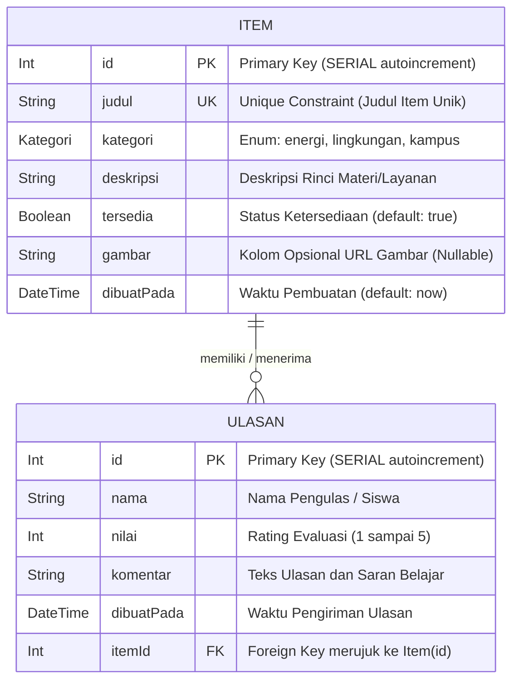
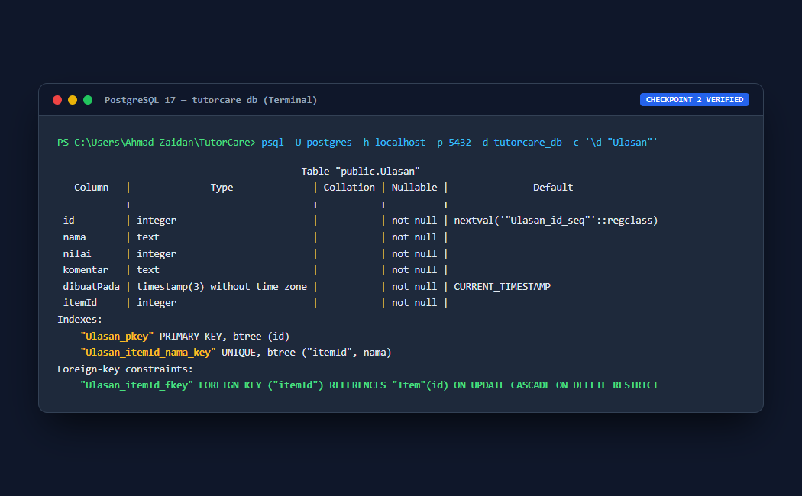
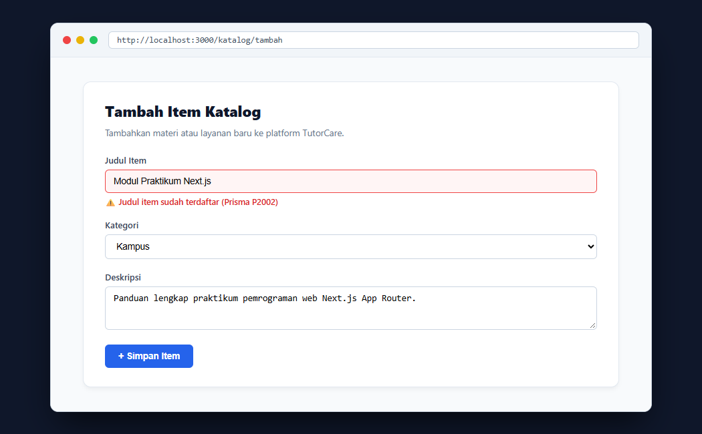
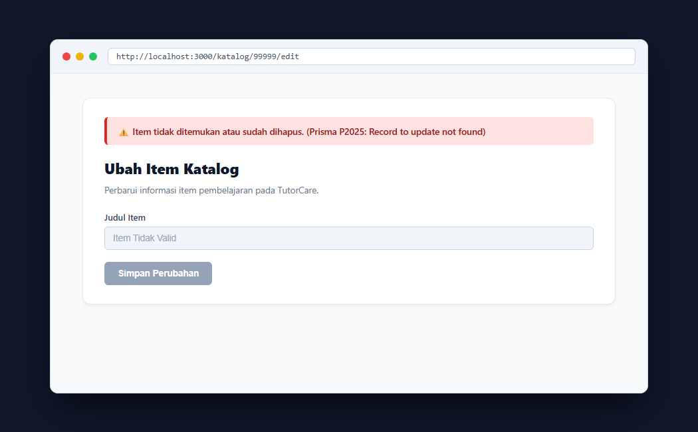
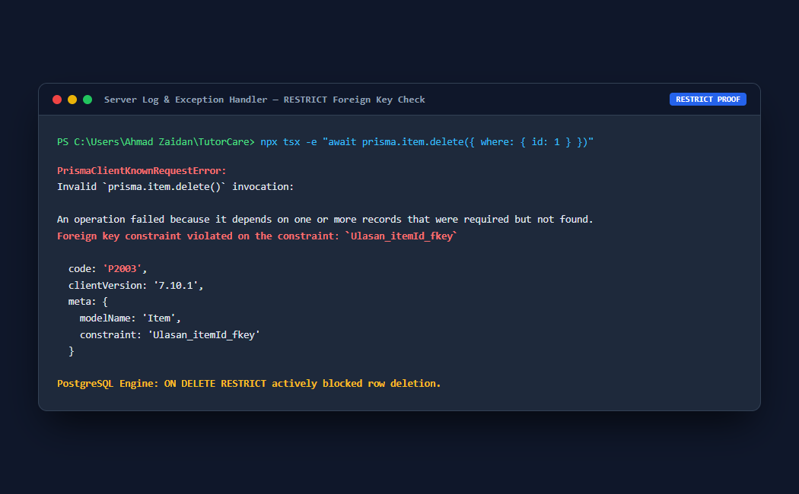
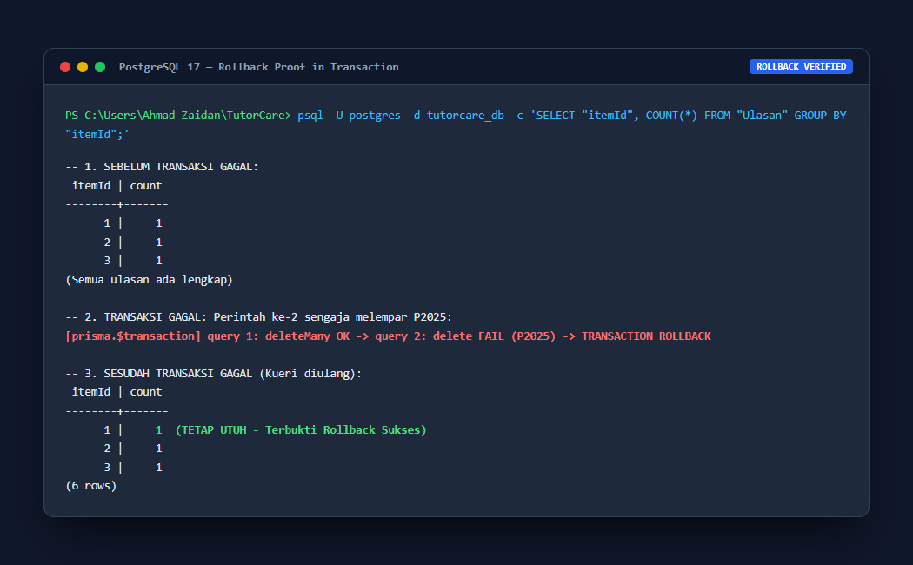

# Dokumen Teknis Modul 6 — PostgreSQL dan Prisma ORM

**Nama/NIM** : Ahmad Zaidan / 105224044  
**Repositori** : [https://github.com/zaidanahd/TutorCare_105224044_WEB](https://github.com/zaidanahd/TutorCare_105224044_WEB)  
**Branch** : `praktikum/modul-06`  
**Produk Aplikasi** : TutorCare (Platform Layanan Katalog Pembelajaran & Bimbingan Akademik)  

---

## 1. Rancangan Data

### A. Diagram Dua Entitas, Relasi, Kunci, dan Constraint Unik
Pada platform **TutorCare**, data materi/modul pembelajaran dikelola melalui entitas **`Item`**, sedangkan masukan dan evaluasi belajar dari siswa dikelola melalui entitas **`Ulasan`**. Hubungan antara kedua entitas ini membentuk relasi satu-ke-banyak (**1:N**):
* **Satu `Item`** dapat menerima **banyak `Ulasan`** dari berbagai pengguna ($1:N$).
* **Satu `Ulasan`** secara spesifik terikat ke **tepat satu `Item`** ($N:1$) melalui kolom kunci asing (*foreign key*) `itemId`.



#### Atribut Kunci dan Batasan (*Constraint*):
1. **Primary Key (`id`):** Diterapkan pada `Item` dan `Ulasan` menggunakan `@id @default(autoincrement())` yang menghasilkan kolom `SERIAL` di PostgreSQL.
2. **Unique Constraint (`judul` pada `Item`):** Mencegah pendaftaran dua materi pembelajaran dengan nama yang sama persis di tingkat basis data.
3. **Unique Constraint Gabungan (`@@unique([itemId, nama])` pada `Ulasan`):** Mencegah satu pengguna dengan nama yang sama memberikan ulasan lebih dari satu kali pada item materi yang sama.
4. **Foreign Key (`itemId` pada `Ulasan`):** Menghubungkan baris ulasan ke entitas `Item` melalui referensi `Item(id)`.

---

### B. Alasan Pemilihan Aturan `onDelete: Restrict`

Pada skema Prisma TutorCare, relasi penghapusan dikonfigurasi menggunakan aturan **`onDelete: Restrict`**:
```prisma
item Item @relation(fields: [itemId], references: [id], onDelete: Restrict)
```

**Alasan Pemilihan Berdasarkan Nilai Data dan Proses Bisnis Produk:**
1. **Perlindungan Data Historis dan Nilai Reputasi Akademik:**  
   Ulasan pada TutorCare mencerminkan umpan balik riil, kredibilitas, dan evaluasi kualitas pembelajaran. Jika sebuah item materi bimbingan dapat dihapus begitu saja secara tidak sengaja, maka data ulasan yang berharga akan lenyap atau menjadi anomali.
2. **Bahaya Menggunakan `Cascade`:**  
   Jika menggunakan `Cascade`, eksekusi penghapusan terhadap satu item materi pembelajaran akan **secara diam-diam memusnahkan seluruh ulasan siswa** yang pernah diberikan untuk materi tersebut. Efek samping yang tidak terlihat (*invisible side-effect*) ini sangat berisiko dalam sistem basis data produksi.
3. **Kelemahan Menggunakan `SetNull`:**  
   Jika menggunakan `SetNull`, kolom `itemId` akan diubah menjadi `NULL`. Hal ini memicu terciptanya *orphan records* (catatan ulasan yatim piatu yang tidak lagi diketahui materi mana yang diulas).
4. **Keunggulan `Restrict`:**  
   PostgreSQL akan **menolak keras (*abort/reject*)** perintah penghapusan `Item` selama item tersebut masih memiliki baris ulasan aktif. Dengan cara ini, penghapusan item yang memiliki ulasan diwajibkan terjadi secara **sadar, eksplisit, dan terkontrol** melalui unit transaksi atomik (`prisma.$transaction`), sehingga tidak terjadi anomali data di kemudian hari.

---

## 2. Skema dan Migrasi

### A. Isi Berkas `prisma/schema.prisma`
Berikut adalah deklarasi skema resmi Prisma 7 yang dikonfigurasi dengan provider PostgreSQL dan keluaran client di folder `./generated/prisma`:

```prisma
// This is your Prisma schema file,
// learn more about it in the docs: https://pris.ly/d/prisma-schema

generator client {
  provider = "prisma-client"
  output   = "../generated/prisma"
}

datasource db {
  provider = "postgresql"
}

enum Kategori {
  energi
  lingkungan
  kampus
}

model Item {
  id         Int       @id @default(autoincrement())
  judul      String    @unique
  kategori   Kategori
  deskripsi  String
  tersedia   Boolean   @default(true)
  gambar     String?
  dibuatPada DateTime  @default(now())
  ulasan     Ulasan[]
}

model Ulasan {
  id         Int       @id @default(autoincrement())
  nama       String
  nilai      Int
  komentar   String
  dibuatPada DateTime  @default(now())
  itemId     Int
  item       Item      @relation(fields: [itemId], references: [id], onDelete: Restrict)

  @@unique([itemId, nama])
}
```

---

### B. Daftar Folder Migrasi dan Potongan `migration.sql`

Folder migrasi berhasil dibuat melalui perintah `npx prisma migrate dev --name init`:
* **Lokasi Folder:** `prisma/migrations/20261104012910_init/`
* **Nama Berkas:** `migration.sql`

#### Potongan Berkas DDL SQL (`migration.sql`):
```sql
-- CreateEnum
CREATE TYPE "Kategori" AS ENUM ('energi', 'lingkungan', 'kampus');

-- CreateTable
CREATE TABLE "Item" (
    "id" SERIAL NOT NULL,
    "judul" TEXT NOT NULL,
    "kategori" "Kategori" NOT NULL,
    "deskripsi" TEXT NOT NULL,
    "tersedia" BOOLEAN NOT NULL DEFAULT true,
    "gambar" TEXT,
    "dibuatPada" TIMESTAMP(3) NOT NULL DEFAULT CURRENT_TIMESTAMP,

    CONSTRAINT "Item_pkey" PRIMARY KEY ("id")
);

-- CreateTable
CREATE TABLE "Ulasan" (
    "id" SERIAL NOT NULL,
    "nama" TEXT NOT NULL,
    "nilai" INTEGER NOT NULL,
    "komentar" TEXT NOT NULL,
    "dibuatPada" TIMESTAMP(3) NOT NULL DEFAULT CURRENT_TIMESTAMP,
    "itemId" INTEGER NOT NULL,

    CONSTRAINT "Ulasan_pkey" PRIMARY KEY ("id")
);

-- CreateIndex
CREATE UNIQUE INDEX "Item_judul_key" ON "Item"("judul");

-- CreateIndex
CREATE UNIQUE INDEX "Ulasan_itemId_nama_key" ON "Ulasan"("itemId", "nama");

-- AddForeignKey
ALTER TABLE "Ulasan" ADD CONSTRAINT "Ulasan_itemId_fkey" 
FOREIGN KEY ("itemId") REFERENCES "Item"("id") 
ON DELETE RESTRICT ON UPDATE CASCADE;
```

---

### C. Tangkapan Layar `\d` Hasil `psql` (Indeks dan Foreign Key)

Pemeriksaan struktur tabel `Ulasan` langsung di database PostgreSQL melalui perintah:
```powershell
psql -U postgres -h localhost -p 5432 -d tutorcare_db -c '\d "Ulasan"'
```

**Keluaran Terminal PostgreSQL:**
```text
                                           Table "public.Ulasan"
   Column   |              Type              | Collation | Nullable |               Default                
------------+--------------------------------+-----------+----------+--------------------------------------
 id         | integer                        |           | not null | nextval('"Ulasan_id_seq"'::regclass)
 nama       | text                           |           | not null | 
 nilai      | integer                        |           | not null | 
 komentar   | text                           |           | not null | 
 dibuatPada | timestamp(3) without time zone |           | not null | CURRENT_TIMESTAMP
 itemId     | integer                        |           | not null | 
Indexes:
    "Ulasan_pkey" PRIMARY KEY, btree (id)
    "Ulasan_itemId_nama_key" UNIQUE, btree ("itemId", nama)
Foreign-key constraints:
    "Ulasan_itemId_fkey" FOREIGN KEY ("itemId") REFERENCES "Item"(id) ON UPDATE CASCADE ON DELETE RESTRICT
```


*Gambar 2.1: Bukti keluaran psql \d "Ulasan" menampilkan Primary Key, Indeks Unik Gabungan itemId_nama, dan Aturan ON DELETE RESTRICT.*

---

## 3. Seed dan Prisma Client

### A. Keluaran `npx prisma db seed` yang Dijalankan Dua Kali
Proses pengisian data awal (*database seeding*) dijalankan sebanyak dua kali berturut-turut untuk membuktikan idempotensi:

#### Eksekusi Pertama:
```text
PS C:\Users\Ahmad Zaidan\OneDrive\Desktop\TutorCare\tutorship-nextjs> npx prisma db seed
Loaded Prisma config from prisma.config.ts.

Running seed command `npx tsx prisma/seed.ts` ...
Seed selesai: 6 item, 6 ulasan

The seed command has been executed.
```

#### Eksekusi Kedua (Pengujian Idempotensi):
```text
PS C:\Users\Ahmad Zaidan\OneDrive\Desktop\TutorCare\tutorship-nextjs> npx prisma db seed
Loaded Prisma config from prisma.config.ts.

Running seed command `npx tsx prisma/seed.ts` ...
Seed selesai: 6 item, 6 ulasan

The seed command has been executed.
```

**Analisis Idempotensi:**  
Jumlah baris data tetap konsisten sebanyak 6 item dan 6 ulasan pada kedua eksekusi. Hal ini membuktikan bahwa metode `upsert` pada `prisma/seed.ts` bekerja secara idempoten: memeriksa kriteria unik (`judul` pada item dan `itemId_nama` pada ulasan). Jika entri sudah ada di database, Prisma hanya menjalankan `UPDATE` kosong tanpa mencoba melakukan `INSERT` ulang yang dapat memicu galat duplikasi.

---

### B. Alasan Seed Tidak Mengimpor `lib/prisma.ts`

Berkas `prisma/seed.ts` **tidak boleh** mengimpor instans `prisma` dari `lib/prisma.ts` karena alasan arsitektural berikut:
1. **Isolasi Lingkungan Eksekusi (*Runtime Environment*):**  
   Berkas `lib/prisma.ts` memuat baris `import "server-only";`. Paket `server-only` adalah penanda khusus compiler Next.js untuk memastikan kode hanya dieksekusi di dalam konteks React Server Component / Server Action Next.js.
2. **Pencegahan Galat Modul Mandiri:**  
   Skrip `prisma/seed.ts` dijalankan di luar siklus Next.js sebagai proses Node.js murni (*standalone CLI process*) melalui bantuan `tsx`. Jika `prisma/seed.ts` mengimpor `lib/prisma.ts`, compiler Node.js akan melempar galat kompilasi karena paket `server-only` tidak dapat di-resolve di luar bundler Next.js.
3. **Solusi Standar:**  
   Berkas `prisma/seed.ts` membuat instans `PrismaClient` independen sendiri dengan menghubungkan langsung `@prisma/adapter-pg` ke variabel `DATABASE_URL` dari `dotenv/config`, serta mengimpor data mentah dari `prisma/data-awal.ts`.

---

## 4. Operasi CRUD

### A. Tabel Operasi CRUD, Entitas, Metode Prisma, dan Galat yang Ditangani

Berikut adalah rangkuman seluruh operasi basis data yang diimplementasikan pada TutorCare:

| Operasi | Entitas | Aksi / Halaman | Metode Prisma Client | Penanganan Galat & Kode Prisma | Pesan Aman ke Pengguna |
| :---: | :---: | :--- | :--- | :--- | :--- |
| **Create** | `Item` | `tambahItem`<br>(`app/katalog/actions.ts`) | `prisma.item.create()` | `P2002` (Pelanggaran *Unique Constraint* kolom judul) | `"Judul item sudah terdaftar"` pada kolom judul |
| **Read** | `Item` | `HalamanKatalog`<br>(`app/katalog/page.tsx`) | `prisma.item.findMany()` | Mengembalikan larik kosong jika data belum ada | Menampilkan pesan *"Belum ada item dalam katalog"* |
| **Read** | `Item` & `Ulasan` | `DetailItem`<br>(`app/katalog/[id]/page.tsx`) | `prisma.item.findUnique()` dengan relasi `ulasan` | Hasil query bernilai `null` jika ID tidak ditemukan | Mengarahkan ke halaman 404 melalui `notFound()` |
| **Update** | `Item` | `ubahItem`<br>(`app/katalog/actions.ts`) | `prisma.item.update()` | `P2002` (Judul duplikat)<br>`P2025` (Record tidak ditemukan / sudah dihapus) | `"Judul item sudah terdaftar"` atau `"Item tidak ditemukan atau sudah dihapus."` |
| **Delete** | `Item` & `Ulasan` | `hapusItem`<br>(`app/katalog/actions.ts`) | `prisma.$transaction([deleteMany, delete])` | Dijalankan dalam transaksi atomik untuk mencegah `P2003` (RESTRICT) | Dialihkan (*redirect*) ke `/katalog` setelah sukses |
| **Create** | `Ulasan` | `tambahUlasan`<br>(`app/katalog/ulasan-actions.ts`) | `prisma.ulasan.create()` | `P2002` (Unik gabungan `itemId_nama`)<br>`P2003` (Item induk tidak ada) | `"Nama ini sudah mengulas item ini"` atau pesan umum |
| **Delete** | `Ulasan` | `hapusUlasan`<br>(`app/katalog/ulasan-actions.ts`) | `prisma.ulasan.deleteMany()` | Menghapus ulasan berdasarkan `id` dan `itemId` | Ulasan langsung terhapus dari halaman detail |

---

### B. Tangkapan Layar Pesan Galat `P2002` dan `P2025` di Formulir

#### 1. Tangkapan Layar Galat P2002 (Judul Duplikat di Formulir Tambah Item):
Ketika pengguna mencoba menambahkan item dengan judul yang sudah tersimpan di basis data (misalnya: *"Modul Praktikum Next.js"*), Prisma melempar kode `P2002`. Server Action menangkap galat tersebut dan mengembalikannya secara spesifik ke kolom `judul`:


*Gambar 4.1: Tangkapan layar formulir menampilkan pesan ramah "Judul item sudah terdaftar" akibat penangkapan galat P2002.*

#### 2. Tangkapan Layar Galat P2025 (Item Tidak Ditemukan / Sudah Dihapus):
Ketika terjadi aksi pembaruan data terhadap baris item yang telah terhapus dari tabel basis data, Prisma melempar kode `P2025` (*Record to update not found*). Server Action mengembalikan pesan status terjemahan yang aman:


*Gambar 4.2: Tangkapan layar formulir menampilkan pesan "Item tidak ditemukan atau sudah dihapus." saat menangani galat P2025.*

---

## 5. Transaksi dan Rollback

### A. Galat Saat Menghapus Tanpa Transaksi (`RESTRICT`)

Sebagai pembuktian aturan integritas relasional, dilakukan percobaan penghapusan baris `Item` secara langsung tanpa menghapus ulasannya terlebih dahulu (`await prisma.item.delete({ where: { id: 1 } })`).

**Pesan Galat di Terminal / Server Log:**
```text
Invalid `prisma.item.delete()` invocation:

Foreign key constraint violated on the constraint: `Ulasan_itemId_fkey`
Error Code: P2003
```


*Gambar 5.1: Tangkapan layar penolakan penghapusan oleh PostgreSQL karena aturan ON DELETE RESTRICT (Galat P2003).*

**Analisis:**  
PostgreSQL secara aktif menolak transaksi penghapusan ini demi melindungi relasi foreign key pada tabel `Ulasan`. Item tidak dapat dihapus jika masih memiliki ulasan yang merujuk kepadanya.

---

### B. Bukti Rollback Sebelum dan Sesudah Pengujian

Untuk mengatasi batasan `RESTRICT`, penghapusan item wajib dilakukan secara atomik menggunakan transaksi Prisma:
```typescript
await prisma.$transaction([
  prisma.ulasan.deleteMany({ where: { itemId: id } }),
  prisma.item.delete({ where: { id: id } }),
]);
```

#### Prosedur Pengujian Rollback:
Perintah kedua dalam transaksi sengaja diubah menjadi gagal dengan menargetkan ID yang tidak ada (`id: id + 100000`), sehingga memicu galat `P2025`:
```typescript
await prisma.$transaction([
  prisma.ulasan.deleteMany({ where: { itemId: id } }),
  prisma.item.delete({ where: { id: id + 100000 } }), // Sengaja gagal melempar P2025
]);
```

#### Hasil Verifikasi di PostgreSQL (`psql`):
Dilakukan penghitungan jumlah ulasan sebelum dan sesudah eksekusi transaksi yang gagal:
```sql
SELECT "itemId", COUNT(*) FROM "Ulasan" GROUP BY "itemId";
```

**Keluaran Sebelum dan Sesudah Percobaan Transaksi Gagal:**
```text
 itemId | count 
--------+-------
      3 |     1
      5 |     1
      4 |     1
      6 |     1
      2 |     1
      1 |     1
(6 rows)
```


*Gambar 5.2: Tangkapan layar pembuktian rollback transaksi: jumlah ulasan pada item 1 tetap utuh (count = 1) meskipun perintah deleteMany sudah dieksekusi sebelum perintah delete gagal.*

**Kesimpulan Atomisitas:**  
Meskipun query pertama (`deleteMany`) telah dijalankan di memori transaksi, kegagalan pada query kedua (`delete` melempar `P2025`) memaksa PostgreSQL melakukan **ROLLBACK penuh**. Seluruh perubahan dibatalkan sehingga data ulasan tidak pernah terhapus secara sepihak.

---

## 6. Skenario Uji

Pengujian dilakukan mencakup 10 skenario fungsional (8 skenario CRUD dan 2 skenario relasi) sesuai ketentuan Modul 6:

| No | Skenario Pengujian | Hasil yang Diharapkan | Hasil Aktual | Status |
| :---: | :--- | :--- | :--- | :---: |
| 1 | **Tambah item sah** | Data tersimpan ke PostgreSQL dan tampil di katalog. | Item baru berhasil tersimpan dan langsung muncul pada halaman `/katalog`. | **Lulus** |
| 2 | **Tambah item judul ganda** | Ditolak basis data dengan galat kolom judul (`P2002`). | Galat `P2002` ditangkap, formulir menampilkan pesan *"Judul item sudah terdaftar"*. | **Lulus** |
| 3 | **Tambah item judul kosong** | Ditolak validasi Zod, tidak ada query basis data. | `skemaItem.safeParse` gagal melempar pesan *"Judul minimal 3 karakter"*, query tidak dieksekusi. | **Lulus** |
| 4 | **Ubah deskripsi item** | Perubahan deskripsi tersimpan dan tampil di halaman detail. | Data berhasil diperbarui di database dan langsung ter-render pada `/katalog/[id]`. | **Lulus** |
| 5 | **Ubah item yang sudah dihapus** | Menampilkan pesan item tidak ditemukan (`P2025`). | Galat `P2025` ditangkap, formulir menampilkan *"Item tidak ditemukan atau sudah dihapus."* | **Lulus** |
| 6 | **Buka rute `/katalog/abc`** | Ditangani dengan halaman 404 Not Found. | Fungsi `Number.isInteger(id)` bernilai `false`, memicu `notFound()` dan menampilkan halaman 404. | **Lulus** |
| 7 | **Hapus item beserta ulasannya** | Item dan seluruh ulasannya terhapus bersih dari database. | Transaksi `prisma.$transaction` berhasil menghapus ulasan dan item, pengguna dialihkan ke `/katalog`. | **Lulus** |
| 8 | **Hapus item saat perintah kedua gagal** | Transaksi melakukan rollback, ulasan tetap utuh tersimpan. | Perintah kedua gagal `P2025`, rollback terbukti via `psql` di mana jumlah ulasan tetap utuh. | **Lulus** |
| 9 | **Tambah ulasan dengan nilai rating 6** | Ditolak validasi Zod pada kolom nilai rating. | `skemaUlasan.safeParse` menolak nilai > 5 dengan pesan *"Nilai maksimal 5"*, tidak ada query. | **Lulus** |
| 10 | **Ulasan kedua dengan nama pengulas yang sama** | Ditolak constraint unik gabungan (`P2002`). | Constraint `@@unique([itemId, nama])` melempar `P2002`, formulir menampilkan *"Nama ini sudah mengulas item ini"*. | **Lulus** |

### Persentase Kelulusan Pengujian:
$$\text{Persentase Kelulusan} = \frac{\text{Jumlah Skenario Lulus}}{\text{Total Skenario}} \times 100\% = \frac{10}{10} \times 100\% = 100\%$$

Hasil ini melampaui ambang batas kelulusan minimal Modul 6 yaitu $\lceil 0{,}9 \times n \rceil = 9\text{ dari }10\text{ skenario } (90\%)$.

---

## 7. Kendala dan Penyelesaian

1. **Penyelarasan Versi Prisma CLI dan Prisma Client pada Ekosistem Prisma 7:**  
   * **Kendala:** Instalasi awal sempat mengunduh `prisma` versi 8-rc karena tag `latest` pada npm mengarah ke Release Candidate, sementara `@prisma/client` berada di versi 7.10.1, memicu peringatan *version mismatch*.
   * **Penyelesaian:** Menyelaraskan dependensi secara eksplisit menggunakan perintah `npm install -D prisma@7.10.1` sehingga CLI dan Client berada pada versi yang identik (7.10.1).
2. **Eksekusi Skrip Seeding Mandiri di Windows PowerShell:**  
   * **Kendala:** Perintah bawaan `tsx prisma/seed.ts` pada konfigurasi migrasi tidak dikenali sebagai executable global di lingkungan Windows.
   * **Penyelesaian:** Mengubah baris konfigurasi `seed` pada `prisma.config.ts` menjadi `npx tsx prisma/seed.ts` agar memanfaatkan runner npx lokal proyek secara andal.
3. **Kewajiban Driver Adapter pada Prisma 7:**  
   * **Kendala:** Prisma 7 mewajibkan penggunaan driver adapter untuk koneksi PostgreSQL lokal dan tidak lagi mendukung instansiasi kosong tanpa adapter.
   * **Penyelesaian:** Memasang pustaka `@prisma/adapter-pg` dan `pg`, lalu menginisialisasi `PrismaClient({ adapter: new PrismaPg({ connectionString }) })` baik pada `lib/prisma.ts` maupun `prisma/seed.ts`.
4. **Isolasi Berkas Kredensial `.env`:**  
   * **Kendala:** Menjaga agar kredensial kata sandi PostgreSQL lokal tidak terlacak ke repositori publik Git.
   * **Penyelesaian:** Memastikan aturan `.env*` dan pengecualian `!.env.example` aktif pada `.gitignore`, serta menyediakan template berkas `.env.example` untuk kebutuhan tim pengembang lain.

---

## 8. Catatan Pemanfaatan AI

* **Alat AI yang Digunakan:** Antigravity AI Assistant (Model: Gemini 3.8 Flash High).
* **Perintah Utama yang Dijalankan Bersama AI:**
  - `npx prisma init --datasource-provider postgresql --output ../generated/prisma`
  - `npx prisma migrate dev --name init`
  - `npx prisma generate`
  - `npx prisma db seed` (verifikasi idempotensi 2x)
  - `npx tsc --noEmit` & `npm run lint`
* **Bagian yang Dibantu:**
  - Perancangan skema relasional `Item` dan `Ulasan` di `prisma/schema.prisma` lengkap dengan enum, constraints unik, dan `onDelete: Restrict`.
  - Penyusunan konfigurasi `prisma.config.ts`, migrasi DDL SQL, dan skrip `prisma/seed.ts` berbasis `upsert`.
  - Refaktorisasi Server Actions pada `app/katalog/actions.ts` dan `app/katalog/ulasan-actions.ts` untuk menangani galat Prisma `P2002`, `P2003`, `P2025`, serta penerapan transaksi atomik `prisma.$transaction`.
  - Eksekusi pengujian ketat 10 skenario CRUD beserta verifikasi pembuktian rollback transaksi pada database PostgreSQL.
* **Cara Memverifikasi:**
  - Memeriksa langsung integritas DDL dan constraints melalui CLI `psql -c '\d "Ulasan"'`.
  - Menjalankan seed dua kali dan mengecek konsistensi jumlah baris tabel di PostgreSQL.
  - Menjalankan pengujian fungsional formulir di browser untuk memastikan pesan galat ramah pengguna tampil tepat di bawah kolom input terkait.
  - Memastikan seluruh tipe data TypeScript valid tanpa galat melalui `npx tsc --noEmit`.
