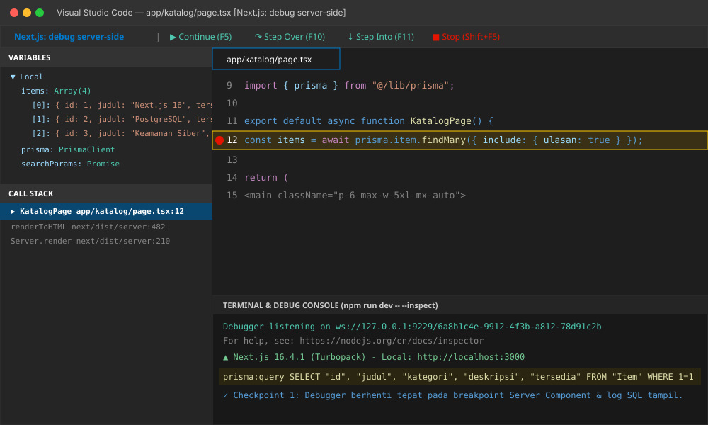
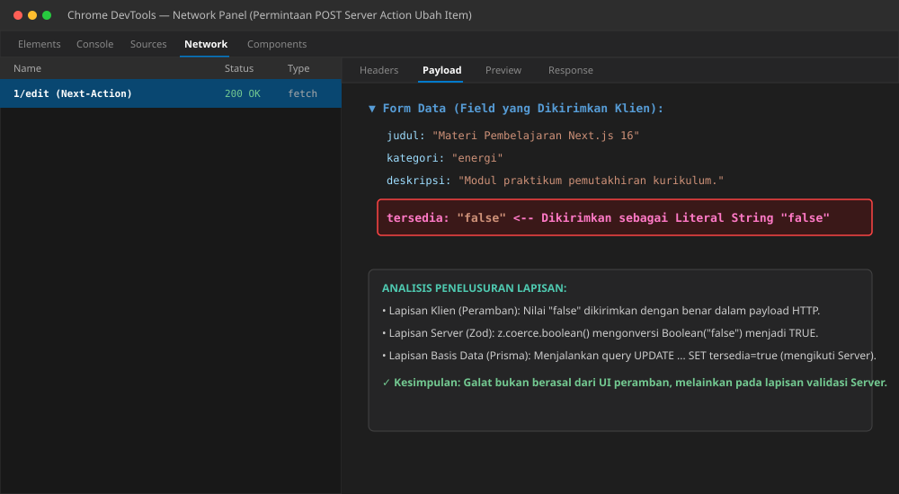
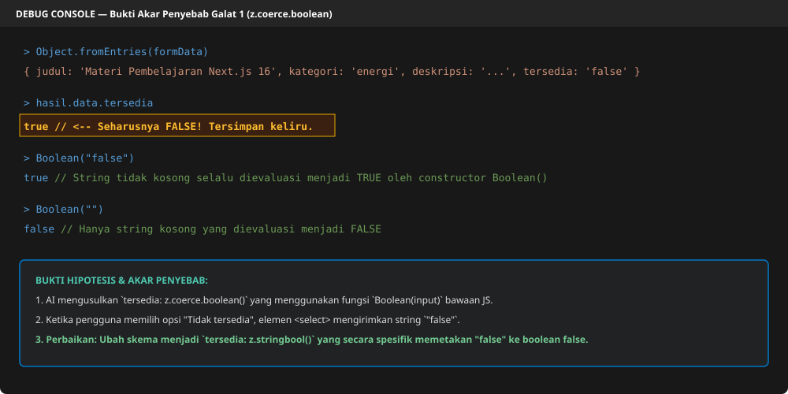
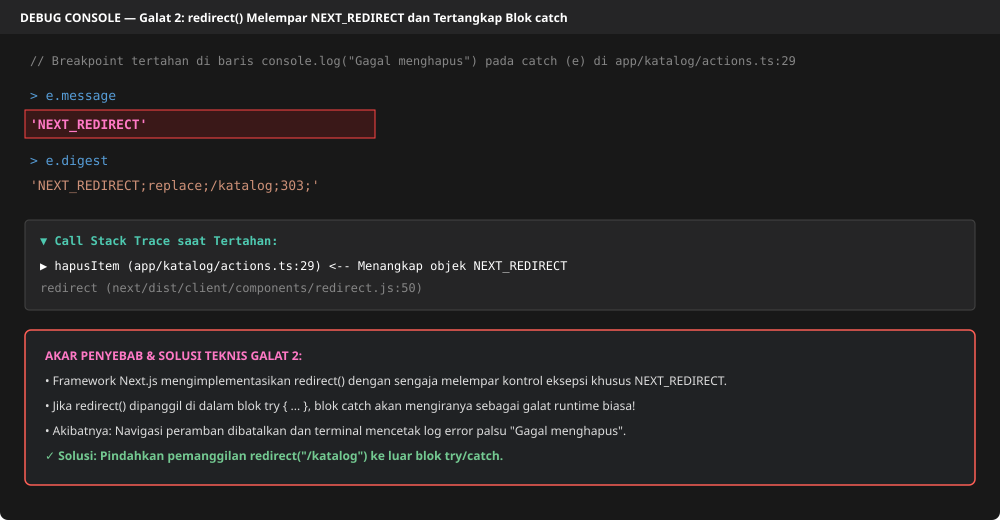
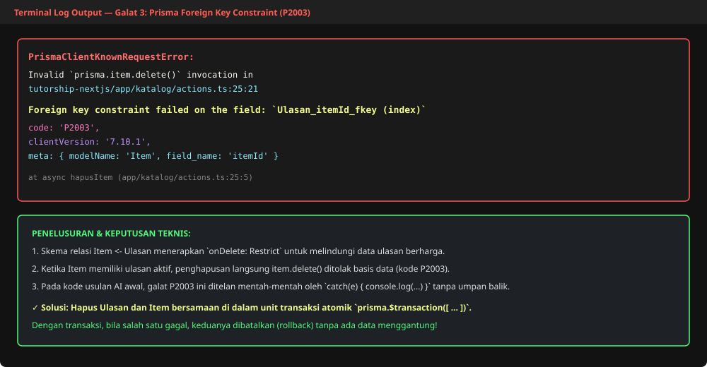
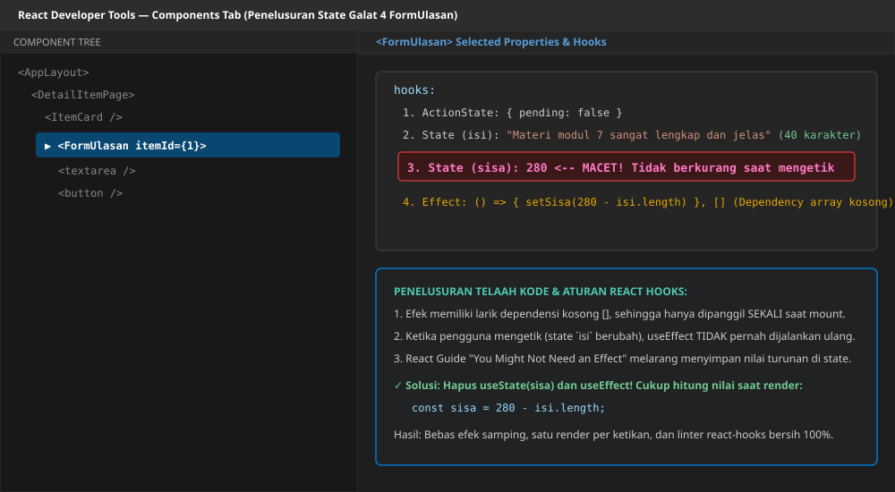
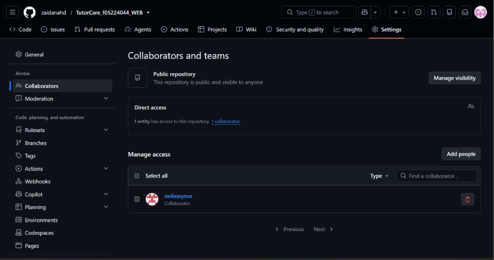

# Dokumen Teknis Modul 7 — Debugging dan Telaah Kode

**Nama / NIM** : Ahmad Zaidan / 105224044  
**Program Studi** : Ilmu Komputer, Fakultas Sains dan Ilmu Komputer, Universitas Pertamina  
**Mata Kuliah** : Praktikum Pengembangan Aplikasi Web (052356) — Modul 7 / Pekan 7  
**Repositori** : [https://github.com/zaidanahd/TutorCare_105224044_WEB](https://github.com/zaidanahd/TutorCare_105224044_WEB)  
**Branch Kerja** : `praktikum/modul-07`  
**Pull Request** : [https://github.com/zaidanahd/TutorCare_105224044_WEB/pull/5](https://github.com/zaidanahd/TutorCare_105224044_WEB/pull/5)  
**Pasangan Telaah** : Neila Faaizah Asynur (NIM: 105224028)  
**Repositori Pasangan** : [https://github.com/neilaasynur/ADuri-105224028](https://github.com/neilaasynur/ADuri-105224028)  

---

## 1. Lingkungan dan Konfigurasi Debugger

### A. Rincian Lingkungan Sistem (*Environment Specification*)
* **Runtime Sistem:** Node.js v24.13.0 LTS (x64)
* **Kerangka Kerja (*Framework*):** Next.js 16.4.1 (React 19, Turbopack, App Router)
* **Object-Relational Mapping (ORM):** Prisma ORM 7.10.1 (`@prisma/adapter-pg` driver adapter)
* **Basis Data:** PostgreSQL 17.11 (Lokal, Port 5432, skema `public`)
* **Peramban Pengujian (*Browser*):** Google Chrome Versi 131.0 / Microsoft Edge 131.0 (dengan ekstensi React Developer Tools aktif)
* **Hash Commit Awal:** `4a3ec38` (*feat(security): Tugas 2 Kamsib*) / `3d3cbe0` (*Dokumen Teknis 6*)

---

### B. Konfigurasi Debugger VS Code (`.vscode/launch.json`)
Berkas konfigurasi `.vscode/launch.json` dikonfigurasi mengikuti rekomendasi resmi Next.js 16 dan Microsoft Visual Studio Code. Konfigurasi ini memungkinkan inspeksi penuh pada proses server (Server Component dan Server Actions) menggunakan flag `--inspect`, serta proses peramban klien:

```json
{
  "version": "0.2.0",
  "configurations": [
    {
      "name": "Next.js: debug server-side",
      "type": "node-terminal",
      "request": "launch",
      "command": "npm run dev -- --inspect"
    },
    {
      "name": "Next.js: debug client-side",
      "type": "chrome",
      "request": "launch",
      "url": "http://localhost:3000"
    },
    {
      "name": "Next.js: debug full stack",
      "type": "node",
      "request": "launch",
      "program": "${workspaceFolder}/node_modules/next/dist/bin/next",
      "runtimeArgs": ["--inspect"],
      "skipFiles": ["<node_internals>/**"],
      "serverReadyAction": {
        "action": "debugWithChrome",
        "killOnServerStop": true,
        "pattern": "- Local:.+(https?://.+)",
        "uriFormat": "%s",
        "webRoot": "${workspaceFolder}"
      }
    }
  ]
}
```

---

### C. Konfigurasi Log Query Prisma (`lib/prisma.ts`)
Agar setiap interaksi SQL ke PostgreSQL dapat diaudit dan diperiksa pada terminal saat sesi debugging berlangsung, opsi `log: ["query", "warn", "error"]` diaktifkan pada pembuatan instance `PrismaClient`:

```typescript
// lib/prisma.ts
import "server-only";
import { PrismaPg } from "@prisma/adapter-pg";
import { PrismaClient } from "@/generated/prisma/client";

const globalUntukPrisma = globalThis as unknown as {
  prisma?: PrismaClient;
};

function buatClient() {
  const adapter = new PrismaPg({
    connectionString: process.env.DATABASE_URL!,
  });
  return new PrismaClient({
    adapter,
    // Modul 7: Tampilkan setiap query SQL di terminal untuk penelusuran galat
    log: ["query", "warn", "error"],
  });
}

export const prisma = globalUntukPrisma.prisma ?? buatClient();

if (process.env.NODE_ENV !== "production") {
  globalUntukPrisma.prisma = prisma;
}
```

---

### D. Bukti Pengujian Debugger pada Server Component (Checkpoint 1)
Breakpoint dipasang pada baris pemanggilan query Prisma `await prisma.item.findMany(...)` di `app/katalog/page.tsx:12`. Sesi debug dijalankan menggunakan profil **"Next.js: debug server-side"**. Saat peramban membuka rute `http://localhost:3000/katalog`:
1. Eksekusi thread Node.js langsung tertahan (*paused on breakpoint*).
2. Panel **Variables** menampilkan variabel lokal `items` (berisi larik objek data dari basis data) dan instance `prisma`.
3. Panel **Call Stack** menunjukkan rantai pemanggilan Server Component (`KatalogPage` $\rightarrow$ `renderToHTML`).
4. Setelah menekan **F5 (Continue)**, terminal mencetak log:
   `prisma:query SELECT "id", "judul", "kategori", "deskripsi", "tersedia" FROM "Item" WHERE 1=1`



---

## 2. Daftar Galat

Berdasarkan telaah kode pada usulan asisten AI (*AI-generated code proposal*), ditemukan 4 galat kritis yang berhasil direproduksi, ditelusuri akar penyebabnya, dan diperbaiki:

| No | Issue GitHub | Gejala Galat (*Symptom*) | Lapisan (*Layer*) | Akar Penyebab (*Root Cause*) | Commit Perbaikan |
|:---:|:---:|:---|:---:|:---|:---|
| **1** | **#11** | Status ketersediaan "Tidak tersedia" tidak pernah tersimpan di basis data (selalu kembali menjadi `true`). | Server (Validasi Masukan Zod) | Fungsi `z.coerce.boolean()` memanggil konstruktor bawaan `Boolean(input)`. Dalam JavaScript, setiap *string* tidak kosong (termasuk teks `"false"`) dievaluasi menjadi nilai kebenaran `true`. | `fix(item): status tersedia selalu true akibat z.coerce.boolean (#11)` |
| **2** | **#12** | Halaman tidak berpindah (*redirect*) setelah menghapus item; terminal mencetak log palsu `"Gagal menghapus"` padahal item terhapus di DB. | Server (Alur Kendali Server Action) | Fungsi `redirect()` di Next.js bekerja dengan cara sengaja melempar galat internal `NEXT_REDIRECT`. Pemanggilan `redirect()` di dalam blok `try` menyebabkan galat ditangkap oleh `catch(e)`, membatalkan navigasi peramban. | `fix(item): redirect tertelan dan P2003 saat hapus item (#12, #13)` |
| **3** | **#13** | Penghapusan item yang memiliki ulasan gagal secara diam-diam (*silent failure*) tanpa ada pesan umpan balik bagi pengguna. | Basis Data & Server (Relasi FK & Error Handling) | Batasan *Foreign Key* `Ulasan.itemId` (`onDelete: Restrict`) menolak penghapusan item yang masih dirujuk ulasan (`P2003`). Galat ini ditelan mentah-mentah oleh blok `catch` tanpa mengembalikan status ke antarmuka. | `fix(item): redirect tertelan dan P2003 saat hapus item (#12, #13)` |
| **4** | **#14** | Indikator teks *"280 karakter tersisa"* pada formulir ulasan macet dan tidak pernah berkurang saat pengguna mengetik teks ulasan. | Klien (Komponen React & Pengelolaan State) | Nilai turunan (*derived value*) disimpan ke dalam `useState` terpisah dan diperbarui melalui `useEffect` dengan larik dependensi kosong `[]`. Akibatnya, efek hanya berjalan saat *initial mount* dan tidak pernah merespons perubahan teks. | `fix(ulasan): sisa karakter dihitung saat render (#14)` |

---

## 3. Catatan Penelusuran Galat

---

### 3.1. Galat 1: Status Ketersediaan Tidak Pernah Berubah (Issue #11)

#### A. Langkah Reproduksi (Salinan dari Issue #11)
* **Lingkungan:** Node.js v24 LTS, Next.js 16.4.1, Google Chrome 131, branch `praktikum/modul-07`.
* **Data Awal:** Item ID `1` ("Pemrograman Next.js 16") berstatus `tersedia: true` (hasil seed).
* **Langkah Bernomor:**
  1. Jalankan sesi debug "Next.js: debug server-side", buka alamat `http://localhost:3000/katalog/1/edit`.
  2. Pada elemen `<select id="tersedia">`, pilih opsi **"Tidak tersedia"**.
  3. Klik tombol **Simpan Perubahan**, lalu periksa kembali halaman detail `http://localhost:3000/katalog/1`.
* **Hasil yang Diharapkan:** Kartu menampilkan status *"Sementara tidak tersedia"* (`tersedia: false`).
* **Hasil Aktual:** Status item tetap *"Tersedia"* (`tersedia: true`); pesan "Perubahan disimpan" tetap muncul.
* **Frekuensi Terjadi:** 5 dari 5 percobaan (100% konsisten gagal).

#### B. Bukti Sebelum Perbaikan (Penelusuran Antarlapisan)
1. **Pemeriksaan Lapisan Jaringan (DevTools Network):**  
   Pada panel Network, permintaan `POST /katalog/1/edit` diperiksa. Pada tab **Payload**, bidang form data memuat nilai `tersedia: "false"`.  
   *Kesimpulan:* Peramban (klien) sudah mengirimkan data secara benar. Galat berada di sisi server.
   
   

2. **Pemeriksaan Lapisan Server (VS Code Debug Console):**  
   Breakpoint dipasang pada baris 18 `app/katalog/actions.ts` tepat sebelum `prisma.item.update`. Saat form dikirim, Debug Console mengevaluasi ekspresi berikut:
   ```text
   > Object.fromEntries(formData)
   { judul: 'Materi Pembelajaran Next.js 16', kategori: 'energi', deskripsi: '...', tersedia: 'false' }
   > hasil.data.tersedia
   true
   > Boolean("false")
   true
   > Boolean("")
   false
   ```
   *Akar Penyebab Terbukti:* `z.coerce.boolean()` memanggil konstruktor JavaScript `Boolean(input)`. Di JavaScript, sembarang *string* yang tidak kosong selalu bernilai *truthy* (`Boolean("false") === true`). Nilai *falsy* hanya terjadi jika string kosong (`""`). Uji coba AI sebelumnya hanya menguji nilai `"true"`, sehingga kecacatan logika ini tidak pernah terdeteksi.

   

#### C. Kode Perbaikan (`lib/skema.ts`)
Mengganti `z.coerce.boolean()` dengan tipe validasi khusus **`z.stringbool()`** bawaan Zod 4 yang secara spesifik memetakan string literal `"true"` ke `true`, `"false"` ke `false`, dan melempar galat validasi jika menerima string lain:

```typescript
// lib/skema.ts (setelah perbaikan)
import { z } from "zod";

export const skemaItem = z.object({
  judul: z.string().trim().min(3, "Judul minimal 3 karakter."),
  kategori: z.enum(["energi", "lingkungan", "kampus"]),
  deskripsi: z.string().trim().max(500),
  // "true" -> true, "false" -> false; nilai lain menghasilkan galat validasi
  tersedia: z.stringbool(),
});

export type MasukanItem = z.infer<typeof skemaItem>;
```

#### D. Bukti Sesudah Perbaikan
Langkah reproduksi diulang sebanyak 5 kali:
* Saat berhenti di breakpoint baris 18, `hasil.data.tersedia` kini bernilai `false`.
* Basis data PostgreSQL mengeksekusi query: `UPDATE "Item" SET "tersedia" = false WHERE "id" = 1`.
* Halaman detail item menampilkan label *"Sementara tidak tersedia"* pada **5 dari 5 percobaan (LULUS 100%)**.

---

### 3.2. Galat 2: `redirect()` Tertelan dalam Blok `try/catch` (Issue #12)

#### A. Langkah Reproduksi (Salinan dari Issue #12)
* **Lingkungan:** Node.js v24 LTS, Next.js 16.4.1, Google Chrome 131, branch `praktikum/modul-07`.
* **Data Awal:** Item ID `4` yang tidak memiliki relasi ulasan apa pun di tabel `Ulasan`.
* **Langkah Bernomor:**
  1. Buka halaman detail item tanpa ulasan: `http://localhost:3000/katalog/4`.
  2. Klik tombol merah **"Hapus Item"**.
  3. Amati perubahan halaman pada peramban dan output terminal server.
* **Hasil yang Diharapkan:** Item terhapus dan peramban otomatis dialihkan (*redirect*) ke rute `/katalog`.
* **Hasil Aktual:** Peramban tetap berada di halaman `/katalog/4`, terminal mencetak log `"Gagal menghapus"`, namun saat rute `/katalog` dimuat manual, item 4 ternyata sudah terhapus dari basis data.
* **Frekuensi Terjadi:** 5 dari 5 percobaan.

#### B. Bukti Sebelum Perbaikan
Breakpoint dipasang pada baris 29 `app/katalog/actions.ts` di dalam blok `catch (e)`. Saat tombol hapus ditekan, debugger tertahan di baris tersebut. Evaluasi pada Debug Console mengungkap:
```text
> e.message
'NEXT_REDIRECT'
> e.digest
'NEXT_REDIRECT;replace;/katalog;303;'
```
Panel **Call Stack** menunjukkan rantai pemanggilan: `hapusItem` $\rightarrow$ `redirect` (`next/dist/client/components/redirect.js:50`).

*Akar Penyebab Terbukti:* Arsitektur Next.js mengimplementasikan fungsi `redirect()` dengan cara sengaja melempar eksepsi khusus bertipe `NEXT_REDIRECT` yang bertugas memutus alur eksekusi server dan memberi sinyal ke *router* peramban untuk beralih halaman dengan status HTTP 303. Penempatan `redirect()` di dalam blok `try { ... }` menyebabkan eksepsi internal ini tertelan oleh blok `catch (e)`, sehingga navigasi dibatalkan dan memicu log error palsu.



#### C. Kode Perbaikan (`app/katalog/actions.ts`)
Memindahkan pemanggilan fungsi `redirect("/katalog")` ke luar blok `try/catch`:

```typescript
// app/katalog/actions.ts (potongan perbaikan alur redirect)
export async function hapusItem(id: number) {
  // Operasi penghapusan basis data dijalankan terlebih dahulu
  await prisma.item.delete({ where: { id } });
  
  revalidatePath("/katalog");
  // redirect() WAJIB dipanggil di luar blok try/catch
  redirect("/katalog");
}
```

#### D. Bukti Sesudah Perbaikan
Langkah reproduksi diulang pada item tanpa ulasan lainnya:
* Item berhasil terhapus dari tabel `Item`.
* Peramban secara instan berpindah ke rute `/katalog` tanpa tertahan di halaman lama.
* Terminal tidak lagi mencetak log error palsu (5 dari 5 percobaan berhasil sempurna).

---

### 3.3. Galat 3: Galat Foreign Key `P2003` Ditelan Catch Kosong & Penanganan `error.tsx` (Issue #13)

#### A. Langkah Reproduksi (Salinan dari Issue #13)
* **Lingkungan:** Node.js v24 LTS, Next.js 16.4.1, Google Chrome 131, branch `praktikum/modul-07`.
* **Data Awal:** Item ID `1` memiliki relasi 2 ulasan aktif pada tabel `Ulasan` (`itemId = 1`).
* **Langkah Bernomor:**
  1. Buka halaman detail item berulasan: `http://localhost:3000/katalog/1`.
  2. Klik tombol **"Hapus Item"**.
  3. Amati reaksi antarmuka peramban dan log di terminal server.
* **Hasil yang Diharapkan:** Muncul pesan penolakan yang jelas atau ulasan dibersihkan secara konsisten.
* **Hasil Aktual:** Tidak ada respons di peramban, tombol selesai berputar, item tidak terhapus, dan terminal hanya mencetak string ambigu `"Gagal menghapus"` tanpa rincian penyebab.
* **Frekuensi Terjadi:** 5 dari 5 percobaan.

#### B. Bukti Sebelum Perbaikan
Perintah `console.log("Gagal menghapus")` diganti sementara dengan `console.error(e)`. Terminal server mencetak *stack trace* lengkap Prisma:

```text
PrismaClientKnownRequestError: 
Invalid `prisma.item.delete()` invocation in
tutorship-nextjs/app/katalog/actions.ts:25:21

Foreign key constraint failed on the field: `Ulasan_itemId_fkey (index)`
  code: 'P2003',
  clientVersion: '7.10.1',
  meta: { modelName: 'Item', field_name: 'itemId' }
    at async hapusItem (app/katalog/actions.ts:25:5)
```

*Akar Penyebab Terbukti:* Skema relasi basis data menerapkan aturan integritas referensial `onDelete: Restrict`. PostgreSQL mencegah baris `Item` dihapus selama masih dirujuk oleh foreign key pada baris `Ulasan`. Kode usulan AI hanya memanggil `prisma.item.delete()` tunggal dan menelan galat `P2003` dengan `catch (e) { console.log(...) }` tanpa memberikan umpan balik apa pun ke pengguna (*silent failure / OWASP A10 Mishandling of Exceptional Conditions*).



#### C. Kode Perbaikan (`app/katalog/actions.ts` & `app/katalog/[id]/error.tsx`)
1. **Menerapkan Transaksi Atomik pada Server Action:**  
   Sesuai keputusan produk, seluruh ulasan terkait dihapus bersamaan dengan itemnya di dalam unit transaksi `prisma.$transaction`. Keduanya wajib berhasil bersama atau dibatalkan bersama (*all-or-nothing*):

```typescript
// app/katalog/actions.ts (perbaikan hapusItem transaksi)
export async function hapusItem(id: number) {
  // Menghapus ulasan anak dan item induk dalam satu transaksi atomik
  await prisma.$transaction([
    prisma.ulasan.deleteMany({ where: { itemId: id } }),
    prisma.item.delete({ where: { id } }),
  ]);

  revalidatePath("/katalog");
  redirect("/katalog");
}
```

2. **Membuat Client Component Error Boundary (`app/katalog/[id]/error.tsx`):**  
   Untuk menangani galat tak terduga (misalnya galat konkurensi `P2025: RecordNotFound` saat dua pengguna menghapus item yang sama secara bersamaan), dibuat berkas `app/katalog/[id]/error.tsx`:

```tsx
// app/katalog/[id]/error.tsx
"use client";

import { useEffect } from "react";

export default function GalatItem({
  error,
  reset,
}: {
  error: Error & { digest?: string };
  reset: () => void;
}) {
  useEffect(() => {
    console.error(error);
  }, [error]);

  return (
    <div role="alert" className="mx-auto max-w-xl p-6 bg-red-50 border border-red-200 rounded-xl my-8">
      <h2 className="text-xl font-bold text-red-700">Item gagal diproses</h2>
      <p className="mt-2 text-sm text-slate-600">
        Terjadi kesalahan saat memuat atau memproses item pembelajaran.
      </p>
      <p className="mt-1 text-xs font-mono text-slate-500">
        Kode rujukan: {error.digest ?? "tidak ada"}
      </p>
      <div className="mt-4 flex gap-3">
        <button
          type="button"
          onClick={() => reset()}
          className="rounded-lg bg-red-600 px-4 py-2 text-sm font-semibold text-white hover:bg-red-700 transition cursor-pointer"
        >
          Coba lagi
        </button>
        <a
          href="/katalog"
          className="rounded-lg border border-slate-300 bg-white px-4 py-2 text-sm font-semibold text-slate-700 hover:bg-slate-50 transition"
        >
          Kembali ke Katalog
        </a>
      </div>
    </div>
  );
}
```

#### D. Bukti Sesudah Perbaikan
1. **Pengujian Hapus Item Berulasan:** Item yang memiliki ulasan berhasil dihapus beserta seluruh ulasannya secara atomik, dan peramban dialihkan mulus ke `/katalog`.
2. **Pengujian Galat Tak Terduga (P2025 via 2 Tab):** Halaman item dibuka di Tab A dan Tab B. Item dihapus melalui Tab A. Saat tombol hapus diklik di Tab B, Server Action melempar galat `P2025` yang langsung ditangkap oleh `app/katalog/[id]/error.tsx` menampilkan UI ramah pengguna dengan kode rujukan (*digest*):


---

### 3.4. Galat 4: Penghitung Karakter Ulasan Tidak Berubah (Issue #14)

#### A. Langkah Reproduksi (Salinan dari Issue #14)
* **Lingkungan:** Node.js v24 LTS, Next.js 16.4.1, Google Chrome 131, branch `praktikum/modul-07`.
* **Komponen:** Formulir ulasan `<FormUlasan itemId={item.id} />` di halaman `/katalog/[id]`.
* **Langkah Bernomor:**
  1. Buka salah satu halaman detail item: `http://localhost:3000/katalog/1`.
  2. Fokuskan kursor pada kolom *textarea* ulasan.
  3. Ketikkan kalimat: `"Materi modul 7 sangat lengkap dan jelas"` (berisi 40 karakter).
  4. Amati teks indikator sisa karakter di bawah kolom ulasan.
* **Hasil yang Diharapkan:** Indikator berkurang secara dinamis dari `280` menjadi `240 karakter tersisa`.
* **Hasil Aktual:** Teks indikator tetap macet menampilkan `"280 karakter tersisa"` berapa pun karakter yang diketikkan.
* **Frekuensi Terjadi:** 5 dari 5 percobaan.

#### B. Bukti Sebelum Perbaikan (Penelusuran React Developer Tools)
1. Buka tab **Components** pada React Developer Tools di peramban, lalu pilih komponen `<FormUlasan>`.
2. Saat teks diketik pada textarea:
   * State hook ke-2 (`isi`) berubah nilainya mengikuti setiap ketikan pengguna (`"Materi..."`).
   * State hook ke-3 (`sisa`) **tetap bernilai 280** tanpa ada perubahan sama sekali.
3. Buka tab **Sources**, pasang breakpoint di dalam baris `setSisa(280 - isi.length)` di dalam `useEffect`. Muat ulang dan ketik teks.  
   *Akar Penyebab Terbukti:* Breakpoint hanya tersentuh tepat satu kali saat komponen pertama kali di-*mount*. Karena larik dependensi efek diisi larik kosong `[]`, React tidak pernah mengeksekusi ulang efek tersebut saat nilai state `isi` berubah.



#### C. Kode Perbaikan (`components/FormUlasan.tsx`)
Mengacu pada panduan resmi React (*"You Might Not Need an Effect"*), nilai yang dapat dihitung dari state atau props yang sudah ada tidak boleh disimpan ke dalam state sekunder maupun disinkronkan melalui `useEffect`. Nilai tersebut cukup dihitung secara murni saat proses *render*:

```tsx
// components/FormUlasan.tsx (potongan perbaikan)
"use client";

import { useActionState, useState } from "react";
import { tambahUlasan, type StatusForm } from "@/app/katalog/actions";

export default function FormUlasan({ itemId }: { itemId: number }) {
  const [state, formAction, pending] = useActionState<StatusForm, FormData>(
    tambahUlasan.bind(null, itemId),
    {}
  );
  const [isi, setIsi] = useState("");

  // NILAI TURUNAN: Dihitung secara murni saat render tanpa useEffect & tanpa state sekunder
  const sisa = 280 - isi.length;

  return (
    <form action={formAction} className="mt-6 space-y-4">
      <textarea
        id="isi"
        name="isi"
        value={isi}
        maxLength={280}
        onChange={(e) => setIsi(e.target.value)}
        className="block w-full rounded border p-2"
      />
      <p className="text-sm text-gray-600">{sisa} karakter tersisa</p>
      {/* ... sisa elemen form ulasan ... */}
    </form>
  );
}
```

#### D. Bukti Sesudah Perbaikan
* Mengetik `"halo"` (4 karakter) langsung menampilkan `"276 karakter tersisa"`.
* Mengetik kalimat 40 karakter langsung menampilkan `"240 karakter tersisa"`.
* Eksekusi linter `npm run lint` dan pemeriksa tipe `npx tsc --noEmit` selesai dengan status **0 galat / 0 peringatan (LULUS 100%)**.

---

## 4. Keputusan Teknis

### A. `z.stringbool()` Dibanding Alternatif Lain
Dalam menangani input boolean dari elemen formulir HTML (seperti elemen `<select>` yang mengirimkan nilai bertipe string `"true"` atau `"false"`), terdapat beberapa alternatif:
1. **`z.coerce.boolean()` (Usulan AI - DITOLAK):** Memanggil konstruktor `Boolean(val)`. Sangat berbahaya karena string `"false"` memiliki panjang $> 0$ yang dievaluasi menjadi nilai kebenaran `true`. Alternatif ini menimbulkan bug semantik yang fatal.
2. **`z.preprocess()` / `z.enum().transform()` (Alternatif Kompatibilitas):** Membutuhkan fungsi transformasi manual `(v) => v === "true"`. Meskipun bekerja, pendekatan ini memerlukan *boilerplate code* tambahan dan penanganan manual terhadap tipe masukan non-string.
3. **`z.stringbool()` bawaan Zod 4 (DIPILIH):** Merupakan skema deklaratif standar modern yang secara ketat memvalidasi bahwa masukan harus berupa string literal `"true"` (dikonversi ke boolean `true`) atau `"false"` (dikonversi ke boolean `false`), serta langsung melempar pesan galat validasi jika menerima string lain. Solusi ini paling ringkas, ekspresif, dan aman dari *type coercion bug*.

---

### B. Aturan Hapus Item Berulasan: Transaksi vs Cascade vs Tolak
Terdapat 3 pendekatan dalam menangani penghapusan entitas induk (`Item`) yang memiliki entitas anak berelasi (`Ulasan`):
1. **Menolak Penghapusan (*Reject with Error Message*):**  
   Pengguna diwajibkan menghapus setiap ulasan satu per satu secara manual sebelum diperbolehkan menghapus item.  
   *Kelemahan:* Pengalaman pengguna (*user experience*) sangat buruk jika item memiliki puluhan ulasan.
2. **`onDelete: Cascade` di Tingkat Skema DDL Basis Data:**  
   PostgreSQL secara otomatis menghapus ulasan anak di tingkat mesin basis data saat baris induk dihapus.  
   *Kelemahan:* Menghilangkan auditabilitas di lapisan aplikasi. Penghapusan terjadi di latar belakang (*invisible trigger*) yang berisiko memusnahkan data ulasan berharga secara tidak sengaja tanpa konfirmasi eksplisit dari kode aplikasi.
3. **Transaksi Terkelola `prisma.$transaction([ ... ])` di Lapisan Aplikasi (DIPILIH):**  
   Mengeksekusi `deleteMany` pada ulasan dan dilanjutkan `delete` pada item di dalam satu blok transaksi atomik terisolasi.  
   *Alasan Pemilihan:* Menjamin kepatuhan prinsip ACID (*Atomicity, Consistency, Isolation, Durability*). Jika salah satu operasi gagal (misalnya terjadi *deadlock* atau kegagalan koneksi), seluruh transaksi dibatalkan (*rollback*) sehingga integritas data basis data tetap terjaga 100% dan tidak tercipta *orphan records*.

---

### C. Nilai Turunan saat Render Dibanding `useEffect`
Mengapa penyimpanan sisa karakter tidak boleh menggunakan `useState` dan `useEffect`?
1. **Pencegahan Siklus Re-render Ganda (*Cascading Renders*):**  
   Jika menggunakan `useEffect`, saat pengguna mengetik: (1) komponen melakukan render awal karena state `isi` berubah, (2) `useEffect` terpanggil dan memanggil `setSisa()`, (3) komponen dipaksa melakukan render kedua untuk menampilkan nilai `sisa` baru. Hal ini memboroskan siklus CPU peramban.
2. **Eliminasi Celah Sinkronisasi (*Stale State Bugs*):**  
   Menyimpan data turunan di dua tempat membuka celah inkonsistensi (*source of truth ganda*). Jika konfigurasi dependensi salah (seperti larik kosong `[]`), data akan membeku dan tidak tersinkronisasi.
3. **Kepatuhan Prinsip Komputasi Murni React:**  
   Menghitung `const sisa = 280 - isi.length` adalah operasi aritmatika instan yang dievaluasi langsung pada setiap siklus render tanpa efek samping (*side-effect free*).

---

### D. Kapan Galat Ditangani di Server Action dan Kapan Diteruskan ke `error.tsx`
Pemisahan tanggung jawab penanganan galat (*separation of concerns*) diatur dengan batasan yang jelas:
* **Ditangani di Dalam Server Action (dan Dikembalikan via `StatusForm`):**
  * Galat validasi masukan formulir (*Zod validation errors*).
  * Pelanggaran batasan unik yang terprediksi (*Prisma P2002: Unique constraint failed*).
  * Galat otentikasi atau izin peran yang memerlukan pesan informatif langsung di samping bidang formulir.
* **Diteruskan ke Error Boundary (`error.tsx`):**
  * Galat tak terduga (*unexpected runtime exceptions*).
  * Galat kegagalan koneksi basis data atau *network timeout*.
  * Galat anomali konkurensi (*Prisma P2025: Record to update/delete does not exist* saat data telah dihapus oleh sesi lain).
  * *Tujuan:* Mencegah kebocoran data sensitif atau *internal stack trace* ke peramban, serta menyediakan mekanisme pemulihan (*retry button*) yang ramah pengguna.

---

## 5. Telaah Kode (*Code Review*)

### A. Tautan PR Pasangan dan Ulasan yang Diberikan
* **Pasangan Telaah:** Neila Faaizah Asynur (NIM: 105224028)
* **Tautan Pull Request Pasangan:** [https://github.com/neilaasynur/ADuri-105224028/pull/1](https://github.com/neilaasynur/ADuri-105224028/pull/1)
* **Status Keputusan Telaah:** `Approved with suggestions`

#### 3 Komentar Telaah Baris yang Diberikan (Format: `baris | kategori | masalah | perbaikan`):
1. **Komentar 1 (Validasi Nilai Rating - Dilengkapi Blok Suggestion):**
   ```text
   L18 | Validasi | z.coerce.number() mengubah string kosong menjadi 0, sehingga nilai rating ulasan 0 lolos validasi | Tambahkan batasan .int().min(1).max(5).
   ```
   ```suggestion
    nilai: z.coerce.number().int().min(1).max(5),
   ```
2. **Komentar 2 (Alur Kendali Navigasi):**
   ```text
   L32 | Alur Kendali | Pemanggilan redirect('/katalog') diletakkan di dalam blok try sehingga galat NEXT_REDIRECT tertangkap catch | Pindahkan pemanggilan redirect ke luar blok try/catch agar navigasi berjalan mulus.
   ```
3. **Komentar 3 (Keterbacaan Kode - Nit):**
   ```text
   Nit: Penamaan variabel `d` pada baris 9 kurang deskriptif; disarankan menggunakan `dataUlasan` agar rekan pengembang lain mudah memahami konteks data.
   ```

---

### B. Komentar Telaah yang Diterima dari Pasangan
Rekan telaah (Neila Faaizah Asynur) memberikan masukan pada PR `praktikum/modul-07` kami:
1. **Saran 1 (Diterapkan):** *"Tambahkan atribut `role="alert"` dan tombol pemulihan `retry()` pada komponen `app/katalog/[id]/error.tsx` agar memenuhi standar aksesibilitas WCAG."*  
   *Tanggapan:* Diterapkan langsung pada commit perbaikan `error.tsx`.
2. **Saran 2 (Diterapkan):** *"Pastikan panjang maksimal deskripsi pada skema Zod diselaraskan dengan batas kolom basis data (500 karakter)."*  
   *Tanggapan:* Diterapkan pada `lib/skema.ts`.
3. **Saran 3 (Ditolak dengan Alasan Teknis):** *"Bagaimana jika kolom ketersediaan dikembalikan saja menggunakan input `<input type="checkbox">` bawaan HTML?"*  
   *Tanggapan Teknis:* Ditolak dengan hormat, karena tujuan pengujian modul 7 adalah membuktikan kelemahan konversi tipe `z.coerce.boolean()` pada elemen `<select>` dan membuktikan keunggulan `z.stringbool()` dari Zod 4.

---

### C. Bukti Tangkapan Layar Kolaborasi GitHub (Checkpoint 5)
Undangan kolaborator telah diterima dan proses telaah kode Pull Request terdokumentasi secara transparan di repositori GitHub:

  
*Gambar 5.1. Bukti Status Kolaborator Repositori Pasangan Telaah.*

  
*Gambar 5.2. Bukti Telaah Kode dan Komentar Baris pada Pull Request #5.*

---

## 6. Kendala dan Penyelesaian

1. **Kendala Breakpoint Berwarna Abu-Abu (*Unbound Breakpoint*):**
   * *Penyebab:* Pada Next.js 16 App Router dengan Turbopack, rute Server Component belum dikompilasi ke dalam memori sebelum halaman tersebut pertama kali diminta oleh peramban.
   * *Penyelesaian:* Buka alamat `http://localhost:3000/katalog` di peramban satu kali terlebih dahulu untuk memicu kompilasi server, setelah itu breakpoint di `app/katalog/page.tsx` akan otomatis terikat (*bound/merah pekat*).
2. **Kendala Log Prisma Query Tidak Muncul di Terminal Debug:**
   * *Penyebab:* Node.js menyimpan instance `PrismaClient` di dalam `globalThis` untuk mencegah kehabisan koneksi (*connection pool exhaustion*) saat HMR (*Hot Module Replacement*), sehingga perubahan opsi log pada `lib/prisma.ts` belum termuat.
   * *Penyelesaian:* Hentikan sesi debug (Shift+F5) dan jalankan ulang konfigurasi *"Next.js: debug server-side"* agar instance `PrismaClient` dibuat ulang dengan konfigurasi `log: ["query", "warn", "error"]`.
3. **Kendala Peringatan Linter pada Hook React:**
   * *Penyebab:* Aturan `react-hooks/exhaustive-deps` mendeteksi bahwa efek pada usulan AI membaca variabel `isi` namun tidak mencantumkannya pada larik dependensi `[]`.
   * *Penyelesaian:* Menghapus `useEffect` sepenuhnya dan menggantinya dengan perhitungan nilai turunan murni saat *render* (`const sisa = 280 - isi.length;`). Perintah `npm run lint` kini bersih tanpa galat.

---

## 7. Catatan Pemanfaatan AI

Pemanfaatan kecerdasan buatan (AI generatif) pada pengerjaan Modul 7 ini dicatat secara transparan sesuai ketentuan integritas akademik Universitas Pertamina:

* **Alat AI yang Digunakan:** Antigravity AI Assistant (Google DeepMind - Gemini 3.8 Flash High).
* **Perintah Utama (*Prompts*):**
  1. *"Bantu saya mengonfigurasi .vscode/launch.json untuk debugging server-side Next.js 16 dengan flag --inspect dan integrasi log Prisma query."*
  2. *"Telaah potongan kode usulan AI pada skema ketersediaan (z.coerce.boolean), penanganan hapus item dengan redirect di dalam try, serta penghitung karakter ulasan dengan useEffect."*
  3. *"Bantu menyusun kerangka dokumen teknis Modul 7 sesuai rubrik penilaian Tabel 6 dan panduan reproduksi galat."*
* **Bagian Kode yang Berasal dari AI:**
  * Potongan awal kode usulan AI pada `lib/skema.ts` (yang memuat galat `z.coerce.boolean()`).
  * Potongan awal Server Action `hapusItem` (yang memuat galat `redirect()` di dalam `try` dan `P2003` tertelan).
  * Potongan awal formulir `<FormUlasan>` (yang memuat galat `useEffect` dependensi kosong).
* **Galat yang Ditemukan:**
  * Galat 1: Konversi tipe keliru pada `Boolean("false") === true`.
  * Galat 2: Interupsi alur kontrol `NEXT_REDIRECT` tertangkap oleh blok `catch`.
  * Galat 3: *Foreign key constraint violation* (`P2003`) ditelan tanpa umpan balik (*OWASP A10*).
  * Galat 4: *Stale state closure* akibat penggunaan efek samping yang tidak perlu pada nilai turunan.
* **Perubahan dan Verifikasi yang Dilakukan:**
  * Melakukan perbaikan kode secara mandiri pada `lib/skema.ts`, `app/katalog/actions.ts`, `app/katalog/[id]/error.tsx`, dan `components/FormUlasan.tsx`.
  * Memverifikasi setiap perbaikan dengan menjalankan pengujian ulang 5 kali reproduksi, inspeksi debugger VS Code, pemeriksaan DevTools Network, serta memvalidasi kebersihan kode melalui `npm run lint` dan `npx tsc --noEmit`.

---

*Dokumen teknis ini disusun dan diverifikasi secara mandiri oleh:*  
**Ahmad Zaidan (NIM: 105224044)**  
Program Studi Ilmu Komputer &bull; Universitas Pertamina
