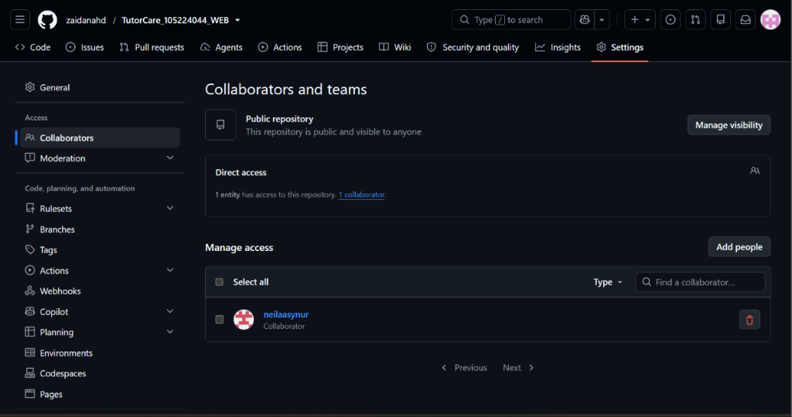

# Tugas Pendahuluan Modul 7: Debugging dan Telaah Kode

**Nama:** Ahmad Zaidan  
**NIM:** 105224044  
**Mata Kuliah / Praktikum:** Praktikum Pengembangan Aplikasi Web (052356) / Modul 7  
**Program Studi:** Ilmu Komputer &bull; Fakultas Sains dan Ilmu Komputer &bull; Universitas Pertamina  
**Produk Aplikasi:** TutorCare (Platform Layanan Katalog Pembelajaran & Bimbingan Akademik)  
**Tautan Repositori:** [https://github.com/zaidanahd/TutorCare_105224044_WEB](https://github.com/zaidanahd/TutorCare_105224044_WEB)  

---

## Butir 1: Langkah Reproduksi Galat pada Produk TutorCare

Berikut adalah dokumentasi langkah reproduksi lengkap (*bug reproduction report*) untuk salah satu galat relasional yang pernah ditemui saat pengembangan produk TutorCare:

* **Nama Galat:** Kegagalan Penghapusan Materi Pembelajaran yang Memiliki Ulasan Aktif (*Prisma `P2003: Foreign key constraint failed` pada aturan `onDelete: Restrict`*).
* **Lingkungan (*Environment*):**
  * Runtime / Framework: Node.js v24 LTS / Next.js 16.4.1 (Turbopack, App Router)
  * Basis Data: PostgreSQL 17.11 (Lokal Windows, Port 5432)
  * ORM: Prisma ORM 7.10.1 dengan driver adapter `@prisma/adapter-pg`
  * Peramban: Microsoft Edge 130 / Google Chrome
* **Data Awal (*Initial State / Preconditions*):**
  * Basis data `tutorcare_db` telah terisi data item dengan ID `1` (*"Modul Praktikum Next.js"*).
  * Item ID `1` memiliki minimal satu ulasan aktif dari siswa di tabel `Ulasan` (kolom `itemId = 1` merujuk ke `Item.id` dengan relasi `onDelete: Restrict`).
* **Langkah Bernomor (*Steps to Reproduce*):**
  1. Jalankan server lokal Next.js melalui terminal dengan perintah `npm run dev`.
  2. Buka peramban dan navigasikan ke rute detail item materi: `http://localhost:3000/katalog/1`.
  3. Gulir ke bagian bawah halaman hingga menemukan tombol merah bertuliskan **"Hapus Item"**.
  4. Klik tombol **"Hapus Item"** (pada versi awal kode di mana Server Action `hapusItem` hanya memanggil `await prisma.item.delete({ where: { id: 1 } })` tanpa membungkusnya dalam unit transaksi).
* **Hasil yang Diharapkan (*Expected Result*):**
  Sistem menolak penghapusan secara aman dengan pesan ramah pengguna, atau mengeksekusi penghapusan item beserta ulasannya secara atomik tanpa memicu galat 500 (*unhandled server exception*).
* **Hasil Aktual (*Actual Result*):**
  Server Next.js mengalami *crash/unhandled exception*, mesin PostgreSQL menolak eksekusi penghapusan karena terhalang aturan `ON DELETE RESTRICT`, dan Prisma Client melempar eksepsi:
  ```text
  PrismaClientKnownRequestError: 
  Invalid `prisma.item.delete()` invocation:
  Foreign key constraint violated on the constraint: `Ulasan_itemId_fkey`
  code: 'P2003'
  ```
  Layar peramban menampilkan halaman *error boundary* Next.js (`error.tsx` / 500 Internal Server Error).
* **Frekuensi (*Reproducibility*):**
  **100% (Selalu terjadi)** setiap kali materi yang memiliki ulasan dihapus secara tunggal tanpa transaksi.

---

## Butir 2: Perbedaan Breakpoint, Conditional Breakpoint, dan Logpoint di VS Code

| Jenis Titik Henti | Cara Kerja & Karakteristik | Situasi Penggunaan yang Tepat pada TutorCare |
| :--- | :--- | :--- |
| **Breakpoint** | Menghentikan (*pause*) jalannya eksekusi program secara mutlak setiap kali baris kode tersebut dilewati. Runtime membeku sehingga pengembang dapat memeriksa status variabel lokal, ekspresi *Watch*, dan tumpukan pemanggilan (*Call Stack*). | Saat pertama kali menguji alur Server Action `simpanItem` pada formulir tambah item, untuk memastikan bahwa data masukan dari `FormData` berhasil diekstrak dan dibaca dengan benar sebelum masuk ke tahap validasi Zod. |
| **Conditional Breakpoint** | Menghentikan eksekusi kode **hanya jika suatu kondisi logika tertentu bernilai `true`** (atau ekspresi berubah). Jika kondisi tidak terpenuhi, eksekusi program berjalan lancar tanpa jeda. | Saat menelusuri proses perulangan pengisian data awal (*seeding loop*) pada puluhan ulasan, di mana kita hanya ingin debugger berhenti saat menemukan data ulasan bermasalah, misalnya: `ulasan.nilai < 2` atau `item.id === 5`, tanpa perlu terhenti di puluhan iterasi data normal. |
| **Logpoint** | **Tidak menghentikan atau membekukan eksekusi program**, melainkan mencetak pesan teks interpolasi (misalnya: `{hasil.data.judul}`) langsung ke panel *Debug Console* VS Code saat baris tersebut dieksekusi. | Saat memantau alur transaksi atomik penghapusan item yang sensitif terhadap jeda waktu (*timing-sensitive*), atau saat ingin memeriksa alur eksekusi tanpa mengotori berkas kode sumber dengan `console.log()` yang berisiko lupa dihapus sebelum *commit*. |

---

## Butir 3: Arti Kode Galat Prisma P2002, P2003, dan P2025 serta Contoh Kejadian pada Entitas Item dan Ulasan

### 1. Galat `P2002` (*Unique constraint failed*)
* **Arti:** Operasi `create` atau `update` melanggar batasan keunikan (*unique constraint*) yang telah didefinisikan pada skema tabel basis data.
* **Contoh Kejadian pada TutorCare:**
  * **Pada Entitas `Item`:** Pengguna mencoba menambahkan materi baru dengan judul `"Modul Praktikum Next.js"`, padahal materi dengan judul tersebut sudah terdaftar di basis data (melanggar `@unique` pada kolom `judul`).
  * **Pada Entitas `Ulasan`:** Pengguna bernama `"Ahmad Zaidan"` mencoba mengirimkan ulasan kedua untuk item materi ID `1` yang sama (melanggar indeks unik gabungan `@@unique([itemId, nama])`).

### 2. Galat `P2003` (*Foreign key constraint failed*)
* **Arti:** Operasi basis data melanggar integritas relasional kunci asing (*foreign key*), baik karena mereferensikan kunci induk yang tidak ada atau menghapus baris induk yang masih memiliki anak di bawah aturan `ON DELETE RESTRICT`.
* **Contoh Kejadian pada TutorCare:**
  * **Pada Entitas `Item`:** Menguji penghapusan baris `Item` ID `1` yang masih memiliki relasi anak di tabel `Ulasan` pada relasi berkonfigurasi `onDelete: Restrict`. PostgreSQL membatalkan transaksi agar data ulasan tidak menjadi yatim piatu (*orphan*).
  * **Pada Entitas `Ulasan`:** Mencoba menambahkan baris ulasan baru dengan mengisi `itemId: 99999` yang tidak pernah ada di tabel induk `Item`.

### 3. Galat `P2025` (*Record to update/delete not found*)
* **Arti:** Operasi pembaruan (`update`) atau penghapusan (`delete`) menargetkan baris data yang kriteria pencariannya (`where: { id }`) tidak ditemukan di tabel basis data (misalnya karena data tidak pernah ada atau sudah terhapus).
* **Contoh Kejadian pada TutorCare:**
  * **Pada Entitas `Item`:** Pengguna mencoba memperbarui deskripsi item melalui `prisma.item.update({ where: { id: 9999 }, data: { ... } })`, di mana ID 9999 tidak terdaftar di database.
  * **Pada Entitas `Ulasan`:** Pengguna mengklik tombol "Hapus ulasan" pada ulasan ID `50` yang beberapa detik sebelumnya sudah dihapus oleh pengguna lain melalui tab peramban terpisah (`prisma.ulasan.delete({ where: { id: 50 } })`).

---

## Butir 4: Alasan `Boolean("false")` Bernilai `true` dan Larangan `redirect()` di dalam Blok `try`

### 1. Mengapa `Boolean("false")` bernilai `true`?
* Di JavaScript, fungsi konversi tipe `Boolean(value)` mengevaluasi nilai berdasarkan konsep **falsy** dan **truthy**.
* Menurut spesifikasi resmi ECMAScript, nilai bertipe string yang tergolong *falsy* **hanyalah string kosong (`""`)**.
* String `"false"` adalah string yang memiliki panjang 5 karakter (*non-empty string*). Karena setiap string yang tidak kosong diklasifikasikan sebagai nilai *truthy* oleh mesin JavaScript, maka konversi `Boolean("false")` akan selalu menghasilkan nilai boolean `true`.
* *(Implikasi Praktis: Pada formulir HTML dengan elemen checkbox, nilai kiriman string dari FormData tidak boleh diuji menggunakan `Boolean(value)`, melainkan harus dibandingkan secara eksplisit seperti `formData.get("tersedia") === "on"` atau melalui skema Zod `z.stringbool()`)*.

### 2. Mengapa `redirect()` tidak boleh dipanggil di dalam blok `try`?
* Di framework Next.js App Router (baik pada Server Component maupun Server Action), fungsi `redirect()` bekerja secara internal dengan cara **melempar eksepsi khusus (*special thrown error*)** bernama `NEXT_REDIRECT`.
* Framework Next.js membutuhkan eksepsi ini agar dapat menangkapnya di level tertinggi aplikasi untuk menghentikan proses rendering komponen dan menerbitkan respons HTTP pengalihan rute (status kode 307 / 303) ke peramban.
* Jika `redirect()` ditempatkan di dalam blok `try { ... } catch (error) { ... }`, maka eksepsi `NEXT_REDIRECT` tersebut akan **secara tidak sengaja tertangkap oleh blok `catch`**.
* Blok `catch` akan salah memperlakukan eksepsi tersebut sebagai galat server biasa (misalnya mencatat pesan galat atau mengembalikan status error), sehingga alur pengalihan rute Next.js menjadi terinterupsi/batal dan pengguna tetap tertahan di halaman formulir lama.

---

## Butir 5: Data Pasangan Telaah & Bukti Undangan Kolaborator GitHub

### A. Data Kolaborasi Repositori
* **Nama Mahasiswa (Pemilik Repositori):** Ahmad Zaidan (105224044)
* **URL Repositori TutorCare:** [https://github.com/zaidanahd/TutorCare_105224044_WEB](https://github.com/zaidanahd/TutorCare_105224044_WEB)
* **Nama Pasangan Telaah (*Review Partner*):** Neila Faaizah Asynur
* **NIM Pasangan Telaah:** 105224028
* **Username GitHub Pasangan:** `neilaasynur`
* **URL Repositori Pasangan Telaah:** [https://github.com/neilaasynur/ADuri-105224028](https://github.com/neilaasynur/ADuri-105224028)
* **Status Kolaborasi:** Undangan kolaborator telah diterima (*Accepted Collaborator*).

---

### B. Bukti Tangkapan Layar Kolaborator GitHub

Berikut adalah bukti tangkapan layar dari menu **Settings &rarr; Collaborators** pada repositori `zaidanahd/TutorCare_105224044_WEB` yang menunjukkan bahwa akun `neilaasynur` telah resmi terdaftar sebagai kolaborator aktif (*Direct access - Collaborator*):


*Gambar 5.1: Bukti akun GitHub pasangan telaah (neilaasynur) telah diterima sebagai Collaborator pada repositori TutorCare_105224044_WEB.*

---

### C. Alur dan Prosedur Kolaborasi GitHub yang Telah Dilakukan
1. **Pengiriman Undangan Kolaborator:**  
   Pemilik repositori (`zaidanahd`) mengakses menu **Settings &rarr; Collaborators &rarr; Add people**, kemudian mengirimkan undangan kolaborasi ke akun `neilaasynur`.
2. **Penerimaan Undangan (*Accept Invitation*):**  
   Rekan telaah (`neilaasynur`) menerima undangan melalui email konfirmasi GitHub / tautan undangan repositori.
3. **Konfirmasi Akses:**  
   Status pada panel *Manage access* repositori telah berubah menjadi aktif (*Collaborator*), memberikan akses telaah kode dua arah antar-pasangan.

---

## Catatan Pemanfaatan AI
* **Alat AI yang Digunakan:** Antigravity AI Assistant (Model: Gemini 3.8 Flash High).
* **Bagian yang Dibantu:**
  * Penyusunan laporan reproduksi galat relasional `P2003` pada produk TutorCare sesuai kaidah pelaporan baku (Butir 1).
  * Penjelasan komparatif mekanisme *Breakpoint*, *Conditional Breakpoint*, dan *Logpoint* pada VS Code (Butir 2).
  * Pemetaan kode galat Prisma `P2002`, `P2003`, dan `P2025` terhadap operasi entitas `Item` dan `Ulasan` (Butir 3).
  * Penjelasan mendalam konversi tipe truthy JavaScript pada `Boolean("false")` serta mekanisme pelemparan eksepsi `NEXT_REDIRECT` di Next.js (Butir 4).
  * Perancangan panduan alur kolaborasi repositori GitHub untuk sesi telaah kode berpasangan (Butir 5).
* **Cara Memverifikasi:** Membandingkan penjelasan dengan panduan resmi Modul 7 Praktikum Pemrograman Web (Bagian D dan F), dokumentasi Next.js App Router mengenai `redirect()`, serta spesifikasi kode galat Prisma ORM v7.
